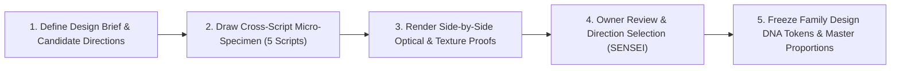
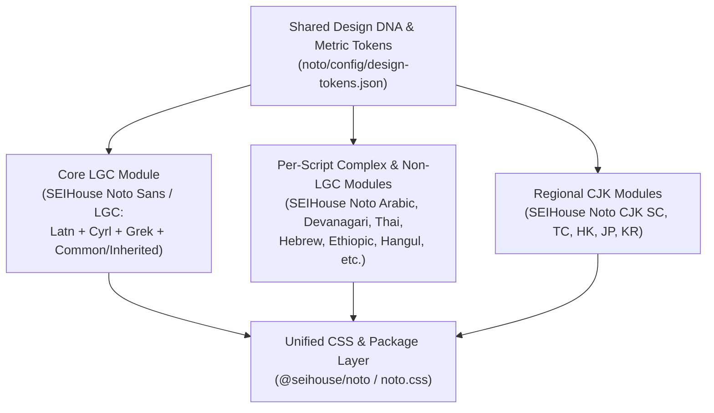
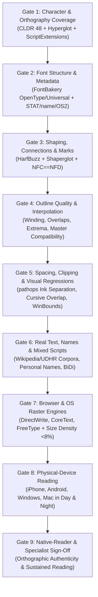
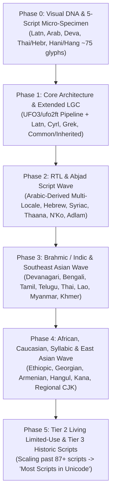

# SEIHouse Noto: Foundational Design & Engineering Handbook

- **Document Status:** Authoritative Repository Reference (Foundational Specification v1.0)
- **Research & Publication Date:** 2026-10-28
- **Repository:** `SEIHouse/seihouse-font-lab`
- **Owner:** SEIHouse Productions LLC, Ohio
- **Applicable Baseline Standards & Tool Versions:**
  - **The Unicode Standard:** Version 16.0.0 (168 scripts, 154,998 characters) and Version 17.0.0 (172 scripts, 159,801 characters); Unicode Standard Annexes UAX #9 (Bidirectional Algorithm), UAX #11 (East Asian Width), UAX #14 (Unicode Line Breaking Algorithm), UAX #15 (Unicode Normalization Forms), UAX #24 (Unicode Script Property), UAX #29 (Unicode Text Segmentation), UAX #31 (Unicode Identifier and Pattern Syntax), UAX #44 (Unicode Character Database), and UAX #50 (Unicode Vertical Text Layout).
  - **Unicode Common Locale Data Repository (CLDR):** Release 48 (Unicode Technical Standard UTS #35, Locale Data Markup Language / LDML) — matching the pinned `languages.json` baseline in this repository.
  - **OpenType Specification:** Version 1.9.1 (Microsoft Typography / ISO/IEC 14496-22:2019 Open Font Format), including OpenType Script Development Specifications and the Universal Shaping Engine (USE).
  - **W3C Web Specifications:** WOFF File Format 2.0 (W3C Recommendation), CSS Fonts Module Level 4 (W3C Candidate Recommendation), and W3C Internationalization (i18n) Language Layout Gap Analysis & Script Resources.
  - **Shaping & Production Tooling Baselines:** HarfBuzz (`uharfbuzz >= 0.56.2`), FontTools (`fonttools[woff] >= 4.66.1`), Skia PathOps (`skia-pathops >= 0.9.2`), AFDKO (`afdko >= 5.0.1` / `otfautohint`), Unified Font Object (`UFO 3`), `ufo2ft`, `fontmake`, FontBakery (`fontbakery >= 1.1.0`), Shaperglot (`shaperglot >= 1.2`), Hyperglot, and `glyphsets >= 1.1`.

---

## Epistemic Classification Legend

Every consequential rule, claim, and architectural choice in this handbook is classified into one of five explicit categories so future agents and human reviewers never confuse hard technical laws with open design questions:

- **`[STANDARD]`** — A requirement imposed by a formal specification (Unicode, OpenType, W3C CSS) or operating-system/browser text engine (HarfBuzz, CoreText, DirectWrite). Violating a `[STANDARD]` produces broken text, missing glyphs, shaping failures, or binary rejection.
- **`[PRACTICE]`** — An established engineering or typographic practice backed by documented evidence from mature multilingual projects, academic research, or production toolchains.
- **`[RECOMMENDATION]`** — A concrete architectural, design, or workflow recommendation tailored specifically for SEIHouse Noto within `seihouse-font-lab`.
- **`[OWNER DECISION]`** — A product, aesthetic, scope, or legal decision that requires explicit approval from the project owner (SENSEI / SEIHouse Productions LLC) before agents lock it in.
- **`[SPECIALIST / NATIVE REVIEW]`** — A script-specific typographic, orthographic, or cultural question that automated tools and non-specialist engineers cannot validate; requires review by a native reader or script specialist before declaring production support.

---

## Project Intent & Non-Negotiable Boundaries

**SEIHouse Noto** is a **new, original multi-script type family** created for SEIHouse Productions LLC with two equally important goals:

1. **Broad, authentic Unicode script support:** Support most writing systems in the Unicode Standard so that text in supported languages displays with the correct characters, shapes, contextual connections, combining marks, and localized forms.
2. **An unmistakable SEIHouse visual identity:** Look cohesively and recognizably SEIHouse across every supported writing system, rather than looking like a patchwork of unrelated system fallbacks.

### Strict Separation from Existing Projects

- **Not SEIHouse Sans (`SEIReader`):** SEIHouse Sans (currently v0.39) is an existing phone-reading family designed specifically around `Literata + Rubik + SEIHouse` (`docs/DESIGN-GOALS.md`). Do not assume SEIHouse Noto must inherit SEIHouse Sans's letterforms, tall-lowercase-equals-cap-height proportion, `85`-unit stroke weight, `1.12` contrast ratio, or spacing tables.
- **Not the SEIHouse Display / Title Engine (`display/` & `@seihouse/living-titles`):** The Display cuts (`Soft`, `Edge`, `Ink`, `Wide`) and the Living Titles runtime are separate display/title systems.
- **Not a renamed copy of Google Noto:** Google's Noto collection is an external industry benchmark for multi-script architecture and coverage. Its outlines, metrics, and design choices must **never** be copied, traced, or merged into SEIHouse Noto.

---

## 1. Scope and Terminology

### 1.1 Core Typographic and Engineering Concepts Explained

For non-specialists and product decision-makers, digital text moves through several distinct layers between stored data and pixels on a screen:

| Term | Plain-Language Meaning | Engineering Definition & Standard Reference |
|---|---|---|
| **Character** | An abstract unit of written language (such as the Latin letter "A", the Arabic letter "Beh", or an invisible instruction like "join these two letters"). | An abstract concept defined by the Unicode Standard, independent of any visual shape ([Unicode Standard, Ch. 2: General Structure](https://www.unicode.org/versions/latest/ch02.pdf)). |
| **Code Point** | The permanent ID number Unicode assigns to a character (written like `U+0041` for `A` or `U+0628` for Arabic `ب`). | An integer in the Unicode codespace `U+0000` to `U+10FFFF` ([Unicode Standard, §2.4 Code Points and Characters](https://www.unicode.org/versions/latest/ch02.pdf)). A single character on screen may be stored in memory as one code point (precomposed) or several code points (decomposed). |
| **Grapheme Cluster** | What a human reader perceives as a single "user-perceived character" or cursor step (for example, `e` + `´` = `é`, or a Devanagari consonant cluster with vowel signs). | A sequence of one base character plus zero or more combining marks or joiners that behave as an indivisible unit for cursor movement and selection ([UAX #29: Unicode Text Segmentation, §3 Grapheme Cluster Boundaries](https://www.unicode.org/reports/tr29/#Grapheme_Cluster_Boundaries)). |
| **Glyph** | A specific visual drawing stored inside a font file. | A numbered graphic shape (`GlyphID` `0` to `65535`) in the font's outline table (`glyf`, `CFF `, or `CFF2`). Characters and glyphs are **not** 1-to-1: one code point may use four different glyphs depending on its position in an Arabic word, or three code points may merge into one ligature glyph ([OpenType Spec: Character to Glyph Mapping (`cmap`)](https://learn.microsoft.com/en-us/typography/opentype/spec/cmap)). |
| **Script** | A writing system—a family of symbols and structural rules used to write one or more languages (for example, `Latin`, `Cyrillic`, `Arabic`, `Devanagari`, `Han`). | Defined formally by the Unicode `Script` (`sc`) and `Script_Extensions` (`scx`) properties ([UAX #24: Unicode Script Property](https://www.unicode.org/reports/tr24/)). |
| **Language** | A spoken or written human communication system (for example, Hindi, Marathi, and Nepali are distinct languages that all use the `Devanagari` script; Uzbek and Kurdish are single languages written in multiple scripts). | Identified in software by BCP 47 language tags (e.g., `sr`, `tr`, `ar`, `zh-Hans`, `ja`) and mapped inside fonts to 4-character OpenType Language System tags (`SRB `, `TRK `, `ARA `, `ZHS `, `JAN `) ([OpenType Language System Tags](https://learn.microsoft.com/en-us/typography/opentype/spec/languagetags)). |
| **Orthography** | The complete set of rules for writing a specific language in a specific script—including its required alphabet/syllabary, diacritics, punctuation, quotation marks, and capitalization rules. | Represented in locale databases via exemplar character sets (`main`, `auxiliary`, `index`, `punctuation`) ([UTS #35: Unicode LDML, Part 1 §5.6 Character Elements](https://www.unicode.org/reports/tr35/tr35-general.html#Character_Elements)). |
| **Font Family** | A coordinated group of fonts sharing a common design across weights (Light, Regular, Bold), styles (Upright, Italic), optical grades (Day, Night), and script modules. | Linked via OpenType `name`, `OS/2`, and `STAT` (Style Attributes) tables, or grouped under a shared CSS `font-family` declaration ([OpenType `STAT` Table](https://learn.microsoft.com/en-us/typography/opentype/spec/stat)). |
| **Shaping** | The automated translation of stored Unicode code points into positioned font glyphs. | Executed by a shaping engine (such as HarfBuzz) reading the font's `cmap`, `GSUB` (Glyph Substitution), `GPOS` (Glyph Positioning), and `GDEF` (Glyph Definition) tables ([HarfBuzz Manual: What is HarfBuzz?](https://harfbuzz.github.io/what-is-harfbuzz.html)). |
| **Fallback** | What happens when a font lacks a character or cluster needed by the text: the browser or OS substitutes another font on the device, or draws a missing-glyph box (`.notdef` / "tofu"). | Governed by CSS font matching per grapheme cluster ([W3C CSS Fonts Module Level 4, §5 Font Matching Algorithm](https://www.w3.org/TR/css-fonts-4/#font-matching-algorithm)). Uncontrolled fallback breaks visual rhythm, line height, and weight consistency. |

### 1.2 Defining and Measuring "Most Scripts" Without Silently Reducing Ambition

`[STANDARD]` In **Unicode 16.0.0**, `Scripts.txt` defines **168 scripts** (plus the three special structural property values `Common` / `Zyyy`, `Inherited` / `Zinh`, and `Unknown` / `Zzzz`). **Unicode 17.0.0** expands this to **172 scripts** ([Unicode 16.0 Summary](https://www.unicode.org/versions/Unicode16.0.0/); [Unicode 17.0 Summary](https://www.unicode.org/versions/Unicode17.0.0/); [UAX #24](https://www.unicode.org/reports/tr24/)).

`[RECOMMENDATION]` Pin **Unicode 16.0.0** (with forward-compatibility tracking for Unicode 17.0.0's 4 added scripts: *Beria Erfe, Sidetic, Tai Yo, Tolong Siki*) and **CLDR 48** as the official accounting baseline for SEIHouse Noto. To prevent agents from redefining "most scripts" downward to mean "only easy scripts," SEIHouse Noto measures progress along **two independent axes**: **Script Breadth** and **Support Depth**.

#### Axis 1: Script Breadth Tiers (Anchored to UAX #31 & UAX #24)

Rather than inventing an arbitrary list, classify all Unicode scripts into four transparent tiers derived from [UAX #31: Unicode Identifiers and Syntax, Table 5 (Recommended Scripts) and Table 7 (Limited Use Scripts)](https://www.unicode.org/reports/tr31/#Table_Recommended_Scripts) and [UAX #24](https://www.unicode.org/reports/tr24/):

| Breadth Tier | Definition & Standard Source | Approximate Script Count (Unicode 16.0 / 17.0) | Examples | Project Ambition Target |
|---|---|---|---|---|
| **Tier S: Shared Structural Foundation** | Characters with `Script=Common` (`Zyyy`) and `Script=Inherited` (`Zinh`), plus cross-script marks listed in `ScriptExtensions.txt`. | Shared across all scripts | Spaces, prose punctuation, ASCII/shared digits, currency signs, general combining diacritical marks (`U+0300–036F`), join controls (`ZWJ`, `ZWNJ`, `◌`). | **100% of prose-relevant characters required** from the first release. |
| **Tier 1: Global & Regional Recommended Scripts** | All scripts in **UAX #31 Table 5 (Recommended Scripts)** — writing systems in widespread modern customary use across global and major regional populations. | **38 scripts** | `Latn`, `Cyrl`, `Grek`, `Arab`, `Hebr`, `Deva`, `Beng`, `Guru`, `Gujr`, `Orya`, `Taml`, `Telu`, `Knda`, `Mlym`, `Sinh`, `Thai`, `Laoo`, `Mymr`, `Khmr`, `Ethi`, `Geor`, `Armn`, `Hang`, `Hira`, `Kana`, `Bopo`, `Hani`, `Thaa`, `Tibt`, `Mong` (and other Table 5 scripts). | **100% required** before claiming global modern script coverage. |
| **Tier 2: Living Limited-Use & Aspirational Scripts** | All modern living scripts in **UAX #31 Table 7 (Limited Use Scripts)** used by active contemporary speech and liturgical communities. | **~45–50 scripts** | `Adlm` (Adlam), `Tfng` (Tifinagh), `Cans` (Canadian Syllabics), `Cher` (Cherokee), `Java` (Javanese), `Bali` (Balinese), `Nkoo` (N'Ko), `Vaii` (Vai), `Bamu`, `Olck` (Ol Chiki), `Rohg` (Hanifi Rohingya), `Syrc` (Syriac), `Copt` (Coptic), `Osge`, `Chak`. | **100% required** to fulfill the "most scripts in Unicode" mandate (~85+ total living scripts across Tiers 1 + 2, exceeding 50% of all encoded Unicode scripts and >99.9% of living written text). |
| **Tier 3: Historic, Epigraphic & Liturgical-Archival Scripts** | Extinct, historical, or epigraphic scripts encoded in Unicode (excluded from UAX #31 modern identifier tables). | **~80–84 scripts** | `Egyp` (Egyptian Hieroglyphs), `Xsux` (Cuneiform), `Brah` (Brahmi), `Phnx` (Phoenician), `Runr` (Runic), `Goth` (Gothic), `Glag` (Glagolitic), `Orkh`, `Ugar`, `Linb`. | **Phased expansion** after Tier 1 & Tier 2 (or prioritized on-demand if SEIHouse stories/lore require specific historical scripts). |

> [!IMPORTANT]
> **`[RECOMMENDATION]` Quantitative Definition of "Most Scripts":**
> SEIHouse Noto may only claim support for **"most modern scripts"** when **100% of Tier 1 (38 scripts)** and at least **50% of Tier 2** pass **Depth Level L3 (Verified Shaping)** or higher. It may only claim support for **"most scripts in the Unicode Standard"** when at least **87 of the 172 Unicode 17.0 scripts (>50.5%)** pass **Depth Level L3** or higher, and every unimplemented script remains explicitly listed as `L0 (Unsupported)` in the coverage ledger.

#### Axis 2: Support Depth Levels (Per Script and Per Orthography)

Never report a script as a binary "supported / unsupported" checkbox. Every script and language orthography in the SEIHouse Noto coverage matrix must carry an explicit **Depth Level (`L0`–`L4`)**:

| Depth Level | Name | What Is Required to Claim This Level | What It Explicitly Does NOT Claim |
|---|---|---|---|
| **`L0`** | **Unsupported** | Zero glyphs or partial design-in-progress not shipped in builds. | Anything. Text falls back to host fonts. |
| **`L1`** | **Code Point Inventory (Draft)** | All required Unicode code points (`cmap`) exist for the target script block or CLDR exemplar set; no `.notdef` boxes appear in isolated character lists. | **Not usable for Complex Scripts.** Does not prove shaping, joining, mark placement, or readability. |
| **`L2`** | **Orthographic & Structural Shaping** | Passes **Hyperglot** / **CLDR 48** (`main` + `auxiliary` + `index` + `punctuation`) inventories in both NFC and NFD; passes **Shaperglot** behavioral checks (`GSUB`/`GPOS`/`GDEF`, `locl`, `ccmp`, `mark`, `mkmk`, script-specific joining/reordering); zero inter-glyph ink collisions or `usWinAscent`/`usWinDescent` clipping. | Does not certify optical harmony across devices or native-reader comfort. |
| **`L3`** | **Multi-Engine & Device Verified** | Passes all `L2` gates **plus** automated raster density/clipping checks across HarfBuzz/FreeType, Windows DirectWrite/ClearType, and Apple CoreText/WebKit in both Day and Night modes at reading sizes (13–22px). | Does not certify native-speaker typographic naturalness. |
| **`L4`** | **Native-Reader & Specialist Certified** | Passes all `L3` gates **plus** documented sign-off by a native reader or script specialist confirming natural letterforms, idiomatic connections/conjuncts, comfortable paragraph texture, and zero cultural/orthographic errors. | **This is the only level that constitutes full production certification.** |

### 1.3 Accounting for Multi-Language Scripts, Punctuation, Numerals, Marks, and Mixed-Script Text

1. **Scripts Used by Multiple Languages & Language-Specific Additions (`[STANDARD]` / `[PRACTICE]`):**
   - Supporting the basic ASCII Latin block (`U+0020–007E`) is not "supporting the Latin script." Under CLDR 48 and Hyperglot, a script spans dozens or hundreds of orthographies.
   - **Latin** requires Pan-European diacritics (`Latin-1`, `Latin Extended-A/B`, `Latin Extended Additional`), Vietnamese double-stacked horn/circumflex/breve + tone marks (`U+1EA0–1EF9`), Pan-African hooks, open vowels, barred letters, and high-density tone stacks (`ɓ ɗ ƙ ƴ ɛ ɔ ₦ ị́ ọ̀ ụ́`), and Indigenous Americas / Pacific glottal/apostrophe letters (`ʻ ʼ  saltillo`).
   - **Cyrillic** requires Slavic (`ru`, `uk`, `be`, `bg`, `sr`, `mk` — including Serbian/Macedonian `locl` italic and upright alternates and Bulgarian traditional forms where applicable) **and** Non-Slavic Cyrillic (`kk` Kazakh, `uz-Cyrl` Uzbek, `ky` Kyrgyz, `mn-Cyrl` Mongolian, `tg` Tajik, `tt` Tatar, `az-Cyrl` Azerbaijani) in `U+0400–052F`.
   - **Arabic** requires not only Modern Standard Arabic (`ar`), but extended characters (`U+0600–06FF`, `U+0750–077F`, `U+08A0–08FF`), contextual joining forms, and localized glyph/numeral forms for Persian (`fa`), Urdu (`ur`), Kurdish Sorani (`ckb`), Pashto (`ps`), Uyghur (`ug`), Sindhi (`sd`), and African Ajami orthographies (`ha-Arab`, `wo-Arab`).
2. **Combining Marks & `ScriptExtensions.txt` (`[STANDARD]`):**
   - Many combining marks have `Script=Inherited` (`Zinh`) or `Script=Common` (`Zyyy`) in `Scripts.txt`, while `ScriptExtensions.txt` ([UAX #24 §4](https://www.unicode.org/reports/tr24/#Script_Extensions)) lists the exact scripts that share each mark (for example, `U+064B–0655` Arabic *harakat* are shared with Syriac; `U+0951–0952` Vedic tone marks are shared across Devanagari, Bengali, Gurmukhi, Gujarati, Odia, Tamil, Telugu, Kannada, and Malayalam; `U+0300–036F` are shared across Latin, Cyrillic, Greek, Coptic, and Tifinagh).
   - **Rule:** Every script module must bundle all combining marks mapped to that script in `ScriptExtensions.txt` plus the dotted circle `U+25CC` (`◌`) so isolated or defective combining sequences shape cleanly inside the same font face.
3. **Punctuation and Numerals (`[STANDARD]`):**
   - Many scripts use both shared ASCII punctuation/digits (`0–9`, `. , ! ?`) and script-native numerals and punctuation: e.g., Arabic-Indic digits (`U+0660–0669`) vs. Extended Arabic-Indic digits (`U+06F0–06F9` for Persian/Urdu, where `4`, `5`, `6` have distinct shapes), Arabic comma/question mark (`، ؟`), Devanagari *danda* and *double danda* (`। ॥`, `U+0964–0965`), Ethiopic wordspace and full stop (`፡ ።`, `U+1361–1362`), and CJK fullwidth punctuation (`。 ， 、 「 」 『 』`).
4. **Mixed-Script Text (`[PRACTICE]`):**
   - Real-world digital text constantly mixes scripts on the same line: Latin brand names, URLs, or numbers embedded inside Arabic, Hindi, Thai, or Japanese sentences. All script modules in SEIHouse Noto must share coordinated baseline alignment, optical density, and line-height metrics so inline script switches never cause vertical jumps or weight jarring.
5. **Distinguishing Script Coverage from Symbols and Emoji (`[RECOMMENDATION]`):**
   - **Prose Script Coverage** (Tiers 1–3) is strictly separate from **Technical/Mathematical Symbols** (`U+2190–2BFF`, `U+1D400–1D7FF`) and **Pictographic/Color Emoji** ([UTS #51: Unicode Emoji](https://www.unicode.org/reports/tr51/)).
   - SEIHouse Noto focuses on **writing systems and typographic punctuation/numerals**. Existing monochrome SEIHouse narrative icons (`U+E000–E00F`, `Ⓢ`) remain in their dedicated symbol layer or app icon font; color emoji and broad mathematical notation blocks are out of scope unless separately commissioned by `[OWNER DECISION]`.

---

## 2. Original Visual Identity

### 2.1 Establishing a Coherent Visual DNA Across Scripts

`[PRACTICE]` Modern multi-script type design research (established by the University of Reading's Department of Typography & Graphic Communication, Rosetta Type, TypeTogether, and Google Fonts Knowledge) rejects **"Latinisation"**—the flawed practice of chopping up Latin letter parts (such as Latin serifs, bowls, or geometric circles) and pasting them onto Arabic, Devanagari, Thai, or Hebrew letters ([Google Fonts Knowledge: Harmonizing Typefaces Across Scripts](https://fonts.google.com/knowledge); [TypeTogether: Multiscript Type Design](https://www.typetogether.com/)). Forcing foreign geometry onto a script destroys its native reading cues and makes text look artificial or illegible to fluent readers.

Instead, multi-script coherence comes from coordinating **optical and structural relationships** while respecting each script's historical ductus (tool path) and spatial conventions.

### 2.2 Ten Core Visual Properties: What Coordinates Globally vs. What Adapts Per Script

| Visual Property | What It Means in Plain Language | Global Family Coordination (`[PRACTICE]`) | Script-Specific Adaptation (`[PRACTICE]` / `[SPECIALIST / NATIVE REVIEW]`) |
|---|---|---|---|
| **1. Proportions & Apparent Size** | How tall and wide letters feel next to each other at the same font size (e.g., 17px). | All scripts must share the same **apparent optical size** when set side-by-side at the same point size. | Mathematical heights **must differ** by script. Unicameral scripts (Hebrew, Thai base consonants, Devanagari base bar height, Hangul syllables, CJK ideographs) do not have a Latin uppercase/lowercase split; setting them exactly to Latin `xHeight` makes them look cramped, while setting them to `capHeight` makes them overpower Latin. For example, Hebrew and Devanagari headline height typically sit between Latin `xHeight` and `capHeight` (~560–640 units on a 1000-unit em). |
| **2. Stroke Construction (Ductus)** | How the virtual pen or brush moves to form the skeleton of a character. | Share a consistent tension along curves (e.g., superelliptical / softly squared vs. circular vs. humanist) and a consistent degree of structural openness. | Never force Latin vertical/horizontal stem logic onto scripts with diagonal or calligraphic construction (e.g., Arabic *Naskh* or *Ruq'ah* skeletons, Devanagari knotted loops, or CJK brush stroke taper). |
| **3. Contrast & Modulation** | The difference between the thickest and thinnest parts of a letter, and the angle where thinning occurs. | Coordinate the **overall contrast class** (e.g., low-contrast sans/grotesk vs. modulated humanist). | **Stress axes differ by script `[STANDARD / PRACTICE]`:** Latin, Greek, Cyrillic, and Devanagari place thick strokes on verticals/right-downward diagonals (broad-nib pen held at ~30–45°); **Hebrew** traditionally has **horizontal-heavy or reverse-axis modulation** (horizontal bars are as thick as or thicker than verticals in traditional square Hebrew; even in low-contrast sans Hebrew, horizontals must not be thinned the way Latin horizontals are); **Arabic** is horizontally driven along the baseline (*kashida* / tooth rhythm). |
| **4. Terminals** | How open stroke ends finish (flat, rounded, angled, sheared, or teardrop). | Share a family-wide terminal vocabulary (e.g., clean perpendicular cuts vs. softly radiused ends) so close-up details feel crafted by the same studio. | Respect mandatory script terminal cues (e.g., Arabic tooth terminals vs. tail exits, Thai loop vs. loopless conventions, CJK *hake* / hook releases). |
| **5. Curve Tension & Joins** | How quickly curves turn at corners and how branches meet stems. | Maintain consistent curve smoothness (G2 curvature continuity where appropriate) and consistent ink-trap / join openness across the family. | Dense scripts (Myanmar, Khmer, stacked Tibetan, complex CJK ideographs) require deeper join thinning and ink clearing at intersections than sparse Latin lowercase letters. |
| **6. Internal Spaces (Counters)** | The enclosed or partially open white spaces inside letters (`a`, `e`, `o`, `م`, `क`, `ก`). | Maintain open apertures across all scripts so letters do not clog or blur on phone screens at 13–17px. | Counter volume scales with script complexity: an Arabic medial `ـهـ` (*Heh*) or Indic conjunct has much smaller internal counters than Latin `o` and needs slightly lighter surrounding strokes to keep its counter open. |
| **7. Horizontal Spacing & Rhythm** | The breathing room inside and between characters and words. | Coordinate the overall **horizontal cadence** (neither overly tracked out nor tightly condensed) so inline mixed-script runs flow without sudden compression or expansion. | Cursive scripts (Arabic, Syriac, N'Ko, Mongolian) have **zero inter-letter gap** between connected letters; their rhythm comes from internal tooth-to-tooth distance. Unspaced scripts (Thai, Lao, Khmer, Myanmar, CJK) have no spaces between words or use spaces for clauses. |
| **8. Apparent Weight & Typographic Color** | How dark or light a paragraph looks from arm's length ("paragraph gray"). | **Equalize typographic color (ink density per square em) across scripts** at every named weight (`Light 300`, `Regular 400`, `Medium 500`, `SemiBold 600`, `Bold 700`). | `[PRACTICE]` A script with many strokes per character (such as Traditional Chinese `Hant`, Japanese `Jpan`, Korean `Hang`, or stacked `Khmr` / `Tibt`) will look **much darker** than Latin if drawn with the exact same mathematical stem thickness. Stroke weights must be optically scaled down for high-density scripts and adjusted per stroke count in CJK. |
| **9. Paragraph Texture** | The overall weave of lines, ascenders, descenders, and marks across a page of prose. | Calm, balanced, non-distracting texture suited for sustained UI and narrative reading. | Accommodate script-specific vertical density: Arabic has deep descenders and multi-tier vocalization marks; Vietnamese and Yoruba have tall diacritic stacks; Devanagari has a continuous horizontal top bar (*shirorekha*) that creates a strong horizontal stripe across the line. |
| **10. Emphasis & Style Variants** | How text signals emphasis, titles, or foreign words within a passage. | Every script module must answer `font-weight` (`300–700`) and `font-style: italic` / oblique requests predictably without browser-synthesized faux bold or faux slant (`font-synthesis: none`). | True cursive italics (`a`, `f`, `g`, `и`, `т`) are native to Latin, Cyrillic, and Greek. Other scripts use script-appropriate upright emphasis, slight rightward/leftward inclination (e.g., leftward slant for RTL Arabic/Hebrew if inclined styles are provided), or stylistic weight/form shifts (`[OWNER DECISION]` & `[SPECIALIST / NATIVE REVIEW]`). |

### 2.3 Script-Specific Conventions That Must Be Respected

Future agents must never violate these structural invariants when adapting the SEIHouse Noto visual DNA:

- **Latin, Greek, and Cyrillic (`Latn`, `Grek`, `Cyrl`):**
  - Greek is not Latin with missing pieces: lowercase Greek (`α β γ δ ε ζ η θ κ λ μ ν ξ π ρ σ ς τ υ φ χ ψ ω`) has a calligraphic flow and fluid bowls distinct from rigid upright Latin stems even in sans-serif designs.
  - Cyrillic (`б в г д ж з и й к л п т ф ц ч ш щ ъ ы ь э ю я`) requires native proportioning (especially in `Д Л У Ф Ц Щ Ы Ю` and lowercase `б з к ф`), plus mandatory localized (`locl`) forms for Serbian/Macedonian (`б г д п т` in italic and `б` in upright) and clear distinction from Latin lookalikes where required.
- **Arabic-Derived Scripts (`Arab`):**
  - Must maintain continuous baseline connection across `init` → `medi` → `fina` forms without visible steps, gaps, or double-thick overlaps.
  - Proportions between tooth height (*Beh/Teh/Theh/Seen*), loop eyes (*Feh/Qaf/Meem/Waw*), vertical ascenders (*Alef/Lam/Kaf*), and deep sub-baseline bowls (*Noon/Seen/Sheen/Yeh/Reh*) must follow authentic *Naskh* (for Arabic/Persian) or *Nastaliq* / *Naskh-Urdu* conventions, never equal-height geometric boxes.
- **Hebrew (`Hebr`):**
  - Unicameral script where lookalike letter pairs—**Bet/Kaf (`ב/כ`), Gimel/Nun (`ג/נ`), Dalet/Resh/Final Kaf (`ד/ר/ך`), He/Het/Tav (`ה/ח/ת`), Vav/Zayin/Final Nun (`ו/ז/ן`), Samekh/Final Mem (`ס/ם`)**—depend on subtle corner overhangs, roof projections, and foot shapes. Rounding off every corner uniformly makes Dalet (`ד`) indistinguishable from Resh (`ר`), destroying legibility.
- **Indic / Brahmic Scripts (`Deva`, `Beng`, `Taml`, `Telu`, `Knda`, `Mlym`, etc.):**
  - Northern Indic scripts (`Deva`, `Beng`, `Guru`) hang from a headline (*shirorekha*), whereas Gujarati (`Gujr`) and Odia (`Orya`) and Southern Indic scripts (`Taml`, `Telu`, `Knda`, `Mlym`, `Sinh`) have distinct structural rhythms (curvilinear bowls, loops, and base alignments).
  - Half-forms and vertical/horizontal conjuncts (`क + ष = क्ष`, `त + र = त्र`, `द + ध = द्ध`) must preserve recognizable root features while fitting within the syllable's visual footprint.
- **Southeast Asian Scripts (`Thai`, `Laoo`, `Khmr`, `Mymr`):**
  - In **Thai (`Thai`)**, traditional **looped** letterforms (`ก ข ค ฆ ง จ ฉ ช ซ ฌ ญ`) rely on the orientation, side, and denting of small circular loops to distinguish consonants at body sizes. While modern "loopless" display styles exist in Thailand, **sustained body reading requires looped forms** (or explicit owner/specialist approval if a hybrid approach is considered) because removing loops removes primary letter-identification cues at small sizes.
- **Ethiopic (`Ethi`):**
  - An *abugida* where each base consonant (*Ge'ez* first order) is modified by hooks, rings, leg shortenings, or crossbar attachments across seven vowel orders. The vowel modifications must be unmistakable at 13–17px without colliding into adjacent dense characters.
- **East Asian Scripts (`Hani`, `Hira`, `Kana`, `Hang`):**
  - **Hangul (`Hang`)** combines *Choseong* (initial consonant), *Jungseong* (medial vowel—vertical, horizontal, or mixed), and optional *Jongseong* (final consonant) into square syllable blocks. A single static drawing of `ㄱ` (*Giyeok*) cannot simply be pasted into every syllable; its width, height, and stroke weight must adapt across 6–24 structural syllable templates so dense blocks like `뷁` (`U+BDDD`) have the same optical grayness as simple blocks like `가` (`U+AC00`).
  - **Han Ideographs (`Hani`)** require optical stroke-weight compensation (a 1-stroke `一` has much thicker strokes than a 24-stroke `靈`), counter balancing inside the *em-box* (typically ~88–92% ideological body face within the 1000-unit em), and strict regional glyph variants (`zh-Hans`, `zh-Hant`, `zh-HK`, `ja`, `ko`).

### 2.4 Proposed Process for Developing and Approving SEIHouse Noto's Visual DNA

`[RECOMMENDATION]` Because SEIHouse Noto is a new, independent family (not an automatic clone of SEIHouse Sans), its visual identity must be established through a structured **Phase 0 Visual DNA Exploration & Approval Gate** before any mass character production begins:



1. **Step 1 — Explore 2 to 3 Distinct Candidate Directions (Do Not Assume SEIHouse Sans):**
   - **Candidate Direction A ("Calm Neo-Humanist"):** Open apertures, subtle stroke modulation (~8–10%), gently curved stems, and crisp perpendicular terminals optimized for universal UI and multilingual long-form text.
   - **Candidate Direction B ("Softly Squared Studio Voice"):** A cousin (not a clone) to SEIHouse's softly squared aesthetic—calibrated specifically for multi-script scalability with lower x-height/cap-height ratio than SEIHouse Sans so tall ascenders and multi-script diacritics have vertical room.
   - **Candidate Direction C ("Balanced Geometric-Humanist"):** Clean, low-contrast monolinear structure with generous internal counters and subtle junction ink traps for high-density complex scripts.
2. **Step 2 — Draw a 5-Script Structural Micro-Specimen (`~60–80 glyphs total`):**
   - Instead of drawing 500 Latin glyphs first and trying to force other scripts to match later, draw a small, simultaneous pangram/word specimen across **five structurally diverse scripts**:
     1. **Latin (`Latn`):** `Hamburgefonstiv` + `Áệị́` (bicameral, ascenders/descenders, stacked diacritics)
     2. **Arabic (`Arab`):** `أبجدية عربية نصية` (RTL, cursive baseline joining, tooth/loop/bowl contrast, dots/marks)
     3. **Devanagari (`Deva`):** `अंतरराष्ट्रीय लिपि` (abugida with *shirorekha* top bar, pre-base/above/below matras, conjuncts)
     4. **Thai (`Thai`) or Hebrew (`Hebr`):** `ภาษาไทยมาตรฐาน` / `טיפוגרפיה עברית` (unspaced looped script with 3-tier vertical marks, or unicameral RTL script with horizontal stress)
     5. **Han + Kana/Hangul (`Hani`/`Hira`/`Hang`):** `永字八法・あいう・한글` (square-frame high-density ideographs and syllabics)
3. **Step 3 — Evaluate Side-by-Side Proofs at Reading Sizes (13px, 15px, 17px, 20px) in Day and Night:**
   - Test mixed-script lines and parallel paragraphs to verify that all five scripts look like one unmistakable SEIHouse family without sacrificing native script authenticity.
4. **Step 4 — `[OWNER DECISION]` Sign-Off:**
   - SENSEI selects the winning visual direction, terminal style, contrast level, and weight range. Only after this approval is recorded in the Decision Log (Section 10.2) may Phase 1 production begin.

---

## 3. Character Construction and Font Engineering

### 3.1 Source Formats, Outline Formats, and Production Pipelines

#### Evaluating Source Formats: Procedural Code vs. UFO3 + DesignSpace

`seihouse-font-lab` currently builds `SEIHouse Sans` and `SEIHouse Display` procedurally from centerline skeletons in [`engine.js`](../engine.js) stroked via [`font_builder.py`](../font_builder.py) (`skia-pathops`).

`[PRACTICE]` While procedural centerline stroking works remarkably well for a single-engine Latin/Cyrillic/Greek family of ~732 glyphs, **a single centerline-plus-oval-pen formula cannot natively draw all Unicode scripts**. Scripts like Arabic (where join cusps, calligraphic tooth entry/exit angles, and tapering tails are non-uniform), Devanagari (where knotted loops and diagonal terminals vary thickness dynamically), and CJK require contour-level control, smart components, and multi-master interpolation.

`[RECOMMENDATION]` Adopt a **Hybrid UFO3 + DesignSpace Architecture** as the canonical intermediate and source standard for SEIHouse Noto:

| Pipeline Layer | Recommended Format / Tool | Why It Applies to SEIHouse Noto |
|---|---|---|
| **Canonical Interchange & Master Source** | **UFO v3 (`.ufo`) + DesignSpace v5 (`.designspace`)** ([Unified Font Object v3 Spec](https://unifiedfontobject.org/versions/ufo3/); [FontTools `designspaceLib`](https://fonttools.readthedocs.io/en/latest/designspaceLib/index.html)) | Open, XML/plist-based, human-readable, Git-diffable directory format supported by every professional font editor (Glyphs via `glyphsLib`, RoboFont, Fontra, FontForge) and every Python compiler (`ufo2ft`, `fontmake`). |
| **Parametric / Procedural Generators (Where Useful)** | Python / JS UFO generators writing into `.ufo` sources | Parametric scripts remain valuable for **geometric/systematic sub-tasks**: generating precomposed diacritic composites, scaffolding Hangul syllable components, generating CJK radical frames, or computing optical spacing profiles—provided they emit standard `.ufo` glyphs + anchors rather than locking the family inside a monolithic browser-evaluated JS file. |
| **OpenType Feature Source** | Modular AFDKO Feature Files (`features.fea`) + `ufo2ft` Feature Writers ([OpenType Feature File Spec](http://adobe-type-tools.github.io/afdko/OpenTypeFeatureFileSpecification.html)) | Allows clean separation of handwritten script shaping logic (`locl`, `isol`, `init`, `medi`, `fina`, `akhn`, `rphf`, `blwf`, `pstf`, `cjct`, `calt`, `rlig`) from auto-generated anchor-based `mark` and `mkmk` tables. |
| **Compiler Pipeline** | **`ufo2ft` + `fontTools` (`fontmake`)** ([`googlefonts/ufo2ft`](https://github.com/googlefonts/ufo2ft); [`googlefonts/fontmake`](https://github.com/googlefonts/fontmake)) | Industry-standard open-source compiler used across Google Fonts and Noto (`notobuilder`). Handles anchor propagation (`propagateAnchors`), overlap removal (`pathops`), curve conversion (`cu2qu` / `qu2cu`), variable font table building (`varLib`), and static instance generation (`instancer`). |

#### Outline Formats: Cubic (`CFF ` / `CFF2`) vs. Quadratic (`glyf`)

`[STANDARD]` OpenType supports two outline flavortypes ([OpenType Spec: Font Tables](https://learn.microsoft.com/en-us/typography/opentype/spec/otff#font-tables)):
1. **Cubic Bézier outlines (`CFF ` for static OTF; `CFF2` for variable OTF):** Native to PostScript/AFDKO `otfautohint` and currently used by `SEIHouse Sans` (`2000 UPM`). Excellent for smooth curves and compact CJK/complex outlines.
2. **Quadratic Bézier outlines (`glyf` + `loca` for static TTF; `glyf` + `gvar` for variable TTF):** The universal standard for variable web fonts (`.woff2` wrapping variable `glyf` has the broadest cross-OS/browser hardware-accelerated support and lowest runtime overhead).

`[RECOMMENDATION]`
- Draw all master outlines using **cubic Bézier curves** in UFO3 sources at a standardized **1000 UPM or 2000 UPM** grid (2000 UPM matches `font_builder.py`'s existing integer precision).
- For **static desktop/app OTFs**, compile `CFF ` (with `otfautohint` where appropriate).
- For **variable fonts and web `.woff2` deliveries**, compile TrueType (`glyf` + `gvar` via `cu2qu`) or static `CFF`/`glyf` `.woff2` depending on the owner's static-vs-variable decision (see Section 5.2), verifying that cubic-to-quadratic conversion error stays below `0.5` font units.

#### Reusable Components, Smart Components, Anchors, and Interpolation

1. **Components & Smart/Variable Components (`[PRACTICE]`):**
   - Never duplicate raw contours for glyphs that are strict combinations of a base glyph and combining marks (e.g., `Á`, `ệ`, `ї`, `أ`, `إ`, `آ`). Use UFO `<component>` references so a refinement to `a` or `hamzaabove-ar` updates every composite automatically.
   - For scripts where repeated shapes change proportion contextually—such as **Hangul Jamo** inside different syllable blocks, **CJK radicals** (e.g., `亻` vs `人`, `氵` vs `水`), or **Arabic tooth/kashida extensions**—use **parametric / smart components** (supported in Glyphs / Fontra / `ufo2ft` filters) with local width/height/crotch-depth axes, decomposing to clean outlines at build time where required by static formats.
2. **Anchor-Based Mark Positioning (`[STANDARD]` / `[PRACTICE]`):**
   - Every base glyph and every combining mark must define named anchors in source (e.g., `top`, `bottom`, `topright`, `ogonek`, `horn`, `center` for Latin; `_top`, `_bottom` on combining marks).
   - For ligatures (`fi`, `fl`, or Arabic ligatures like `lam_alef-ar` `لا` and `allahu-ar`), define numbered ligature component anchors (`top_1`, `top_2`, `bottom_1`, `bottom_2`) so `ufo2ft` compiles `GPOS` Lookup Type 5 (`MarkToLigaturePos`) and attaches vowel/tone marks to each consonant inside the ligature independently.
3. **Multi-Master Interpolation & Weight Development (`[PRACTICE]`):**
   - Instead of computing weights solely by thickening a single centerline (which causes tight inner counters in `e`, `s`, `a`, `م`, `क`, `漢` to close up at Bold `700`), design **compatible master outlines** (at minimum a **Light/Thin master** and a **Bold/Black master**, plus a **Regular master** for complex scripts where stroke relationships shift non-linearly).
   - Ensure strict **point/contour compatibility** across masters: identical contour count, identical contour order, identical start nodes, and matching clockwise/counter-clockwise winding directions so `fontTools.varLib` can interpolate any intermediate weight (`300`, `400`, `500`, `600`, `700`) and optical grade (`Night` grade `-4`).

### 3.2 Unicode Mapping, Normalization, Variation Sequences, and OpenType Layout

1. **Unicode Mapping (`cmap`) & Normalization (`NFC` vs. `NFD`) (`[STANDARD]`):**
   - Text on the web and across macOS/iOS (which historically favors NFD in filenames and some input paths) vs. Windows/Linux/Android (which favors NFC) arrives in both precomposed (`NFC`) and decomposed (`NFD`) forms ([UAX #15: Unicode Normalization Forms](https://www.unicode.org/reports/tr15/)).
   - **Rule:** Every font module must include both precomposed code points in `cmap` (so browsers do not trigger character-level font fallback before shaping) **and** `ccmp` / `mark` / `mkmk` rules so that `shape(font, NFC(text))` and `shape(font, NFD(text))` produce **identical rendered ink positions** (proven in this repo by `verify_latin.py` and `verify_phase4.py`).
   - Where Unicode specifies **canonical decomposition discourage-use** (such as Tibetan subjoined stacks or certain Indic split vowels that HarfBuzz decomposes automatically during shaping), follow HarfBuzz's documented normalization stage rather than fighting it ([HarfBuzz Manual: Normalization](https://harfbuzz.github.io/)).
2. **Unicode Variation Sequences (`UVS` / `SVS` / `IVS`) (`[STANDARD]`):**
   - Encoded in `cmap` Subtable Format 14 ([OpenType `cmap` Format 14: Unicode Variation Sequences](https://learn.microsoft.com/en-us/typography/opentype/spec/cmap#format-14-unicode-variation-sequences)).
   - **Standardized Variation Sequences (SVS):** Required for text vs. emoji presentation selectors (`U+FE0E` `VS15` text presentation vs. `U+FE0F` `VS16` emoji presentation) and specific script variants (such as Mongolian free variation selectors `U+180B–180D` and Phags-pa).
   - **Ideographic Variation Sequences (IVS):** Registered in the Unicode Ideographic Variation Database ([UTS #37: Unicode Ideographic Variation Database](https://www.unicode.org/reports/tr37/)) using Variation Selectors Supplement (`U+E0100–E01EF`), essential for Japanese (`Adobe-Japan1`), HKSCS, and scholarly CJK personal/place names where two distinct historical ideograph shapes share one Unicode code point.
3. **OpenType Tables (`GSUB`, `GPOS`, `GDEF`, `BASE`) (`[STANDARD]`):**
   - **`GDEF` (Glyph Definition Table):** Every glyph must be classified into `1` (Base glyph), `2` (Ligature glyph), `3` (Mark glyph — **must have `0` advance width in `hmtx`**), or `4` (Component glyph). `MarkAttachClassDef` and `MarkGlyphSetsDef` must partition upper, lower, and spacing marks so `UseMarkFilteringSet` and `IgnoreMarks` lookup flags work accurately ([OpenType `GDEF` Spec](https://learn.microsoft.com/en-us/typography/opentype/spec/gdef)).
   - **`GSUB` (Glyph Substitution Table):** Implements `locl` (Localized Forms), `ccmp` (Glyph Composition/Decomposition), positional joining (`isol`, `init`, `medi`, `fina`), Indic/SEA cluster formation (`akhn`, `rphf`, `blwf`, `half`, `pstf`, `cjct`, `pref`), required ligatures (`rlig`), contextual alternates (`calt`), standard ligatures (`liga`), and numeric/stylistic alternates (`tnum`, `sups`, `subs`, `frac`, `ss01–ss20`).
   - **`GPOS` (Glyph Positioning Table):** Implements cursive attachment (`curs` Lookup Type 3), mark-to-base (`mark` Lookup Type 4), mark-to-ligature (`mark` Lookup Type 5), mark-to-mark (`mkmk` Lookup Type 6), kerning/pair adjustment (`kern` / `dist` Lookup Type 2), and contextual positioning (`abvm`, `blwm` for Indic/SEA marks).
   - **`BASE` (Baseline Table):** Defines script-specific alignment baselines (`romn` Roman baseline for Latin/Cyrillic/Greek/Arabic/Hebrew, `hang` hanging baseline for Devanagari/Tibetan, `ideo` ideographic em-box bottom/center baseline for CJK) ([OpenType `BASE` Spec](https://learn.microsoft.com/en-us/typography/opentype/spec/base)).

### 3.3 Strict Separation of Responsibilities: Font vs. Text Engine / Application

Future agents must never try to solve text-engine responsibilities inside font tables, or assume the text engine will magically fix missing font tables:

| Responsibility | Owner | Governing Standard | What the Font Must Do | What the App / Text Engine (HarfBuzz + Browser) Must Do |
|---|---|---|---|---|
| **Script, Language & Direction Itemization** | **Text Engine / App** | [UAX #24](https://www.unicode.org/reports/tr24/), [BCP 47](https://www.rfc-editor.org/info/bcp47) | Declare supported `script` and `language` tags in `GSUB`/`GPOS` (`latn`, `arab`, `dev2`, `TRK `, `SRB `, `URD `, `ZHS `, `JAN `). | Split mixed text into single-script runs; pass the correct HTML `lang="..."` and `dir="ltr\|rtl\|auto"` attributes to the shaper buffer. |
| **Bidirectional (BiDi) Layout & Mirroring** | **Text Engine / App** (with font glyph support) | [UAX #9: Unicode Bidirectional Algorithm](https://www.unicode.org/reports/tr9/) | Draw RTL glyphs (`Arab`, `Hebr`, `Thaa`, `Nkoo`, `Adlm`, `Syrc`) with positive advance widths designed to be placed right-to-left; provide mirrored glyphs (`rtlm`) where character mirroring is not covered by standard Unicode paired bracket substitution. | Resolve embedding levels, reorder LTR numbers/words inside RTL paragraphs, and mirror paired characters like `( ) [ ] { } « »` using `Bidi_Mirrored` properties. |
| **Grapheme Clustering & Cursor / Selection Boundaries** | **Text Engine + Font `GDEF`** | [UAX #29: Text Segmentation](https://www.unicode.org/reports/tr29/), [OpenType `GDEF`](https://learn.microsoft.com/en-us/typography/opentype/spec/gdef) | Classify bases, ligatures, and marks in `GDEF`; provide `LigatureCaretList` (`LigatureCaretByPos`) for multi-character ligatures where internal caret stops are expected. | Compute grapheme boundaries and map HarfBuzz cluster IDs back to DOM character offsets. |
| **Syllable Reordering & Joining State Machine** | **Shaping Engine (HarfBuzz / USE) + Font `GSUB`/`GPOS`** | [OpenType Script Specs](https://learn.microsoft.com/en-us/typography/script-development/standard-scripts) | Implement the exact feature tags (`init`, `medi`, `fina`, `rphf`, `pref`, `blwf`, `pstf`) and anchor lookups expected by the script's shaper state machine. | Run the Arabic joining algorithm or Indic/USE syllable state machine, insert dotted circles (`U+25CC`) for defective clusters, and physically reorder pre-base glyphs (such as Devanagari short `ि` `U+093F` or Thai/Myanmar pre-base vowels). |
| **Line Breaking, Word Wrapping & Justification** | **Text Engine / App** | [UAX #14: Unicode Line Breaking Algorithm](https://www.unicode.org/reports/tr14/), [CSS Text Level 4](https://www.w3.org/TR/css-text-4/) | Provide accurate advance widths for spaces (`U+0020`, `U+00A0`, `U+2009`, `U+202F`, `U+200B` zero-width space, `U+1361` Ethiopic wordspace, `U+0640` Arabic *tatweel*). | Segment lines at spaces, hyphens, or dictionary/ICU phrase boundaries (mandatory for Thai, Lao, Khmer, Myanmar, and CJK). **A font cannot break lines.** |
| **Case Conversion (`upper`/`lower`)** | **Application** | [Unicode Default Case Conversion & SpecialCasing.txt](https://www.unicode.org/Public/UCD/latest/ucd/SpecialCasing.txt) | Supply distinct glyphs for `I`, `İ`, `i`, `ı` (`U+0049`, `U+0130`, `U+0069`, `U+0131`) and `locl` rules (`sub i by i.loclTRK`) so ligatures like `fi` do not eat the dot in Turkish/Azerbaijani. | Perform locale-aware string case conversion (`toLocaleUpperCase('tr')`) in JavaScript/CSS. **OpenType `locl` cannot turn uppercase `I` into `İ` when an app calls `.toUpperCase()` without a locale.** |

### 3.4 Engineering Challenges of Major Script Groups

#### A. Arabic-Derived Scripts (`Arab`: Arabic, Persian, Urdu, Kurdish, Pashto, Uyghur, Sindhi, Jawi, Ajami)

- **Standard & Shaper:** OpenType tag `arab`, shaped by the HarfBuzz Arabic shaper ([Microsoft OpenType Spec: Arabic](https://learn.microsoft.com/en-us/typography/script-development/arabic); [Unicode Standard, Ch. 9: Middle Eastern Scripts](https://www.unicode.org/versions/latest/ch09.pdf)).
- **Joining Mechanics (`[STANDARD]`):** Characters have `Joining_Type` (`Dual_Joining`, `Right_Joining`, `Non_Joining`, `Transparent` for marks) in Unicode `ArabicShaping.txt`. The shaper assigns each character in a word a state and triggers `isol` (isolated), `init` (initial), `medi` (medial), or `fina` (final) in `GSUB`, followed by `rlig` (mandatory ligatures like **Lam-Alef `لا / لأ / لإ / لآ / ـلا`**), `calt` (contextual tooth heights to prevent three-tooth collisions when *Beh/Teh/Seen* sit adjacent to *Seen*), and `curs` / `mark` / `mkmk` in `GPOS`.
- **Nuqta (Dot) & Harakat (Vowel/Diacritic) Management (`[PRACTICE]`):**
  - Over 60% of Arabic-script consonants share a small set of base skeletons (*rasm*, such as the `ٮ` *dotless beh* arch, `ح` *hah*, `د` *dal*, `ر` *reh*, `س` *seen*, `ص` *sad*, `ط` *tah*, `ع` *ain*, `ف` *feh*, `ك` *kaf*, `ل` *lam*, `م` *meem*, `ه` *heh*, `و` *waw*, `ى` *alef maksura*) differentiated by 1, 2, 3, or 4 dots (*i'jam* / *nuqta*), small *tah*, rings, or bars above and below.
  - **Component Strategy:** Construct dotless *rasm* base glyphs (`behDotless-ar.init`, `.medi`, `.fina`, `.isol`) and attach dot clusters (`twodotsabove-ar`, `threedotsabove-ar`, etc.) via components, then propagate `top` and `bottom` anchors so vocalization marks (*fatha*, *kasra*, *damma*, *shadda*, *sukun*, *tanwin*) stack cleanly above or below the consonant dots via `mkmk` without colliding.
- **Language-Specific Localizations (`locl`) (`[STANDARD]` / `[SPECIALIST / NATIVE REVIEW]`):**
  - **Persian (`FAR `) & Urdu (`URD `):** Use `U+06CC` (*Farsi Yeh*, dotless in final/isolated, two dots below in initial/medial) and `U+06A9` (*Keheh*). Urdu additionally requires `U+06C1` (*Heh Goal* `ہ` with distinct contextual hooks/waves vs. Arabic `U+0647` `ه`), `U+06BE` (*Heh Doachashmee* `ھ` for aspirated consonants), and distinct shapes for Extended Arabic-Indic digits `۴ ۵ ۶` (`U+06F4–06F6`, where Urdu `۴` `۶` `۷` also use `locl` alternates).
  - **Naskh vs. Nastaliq Scope Note (`[RECOMMENDATION]`):** Standard horizontal UI/prose Arabic and Persian use a modulated or low-contrast *Naskh*-derived structure (`curs` attachment optional if baseline connections are horizontal). True cascading *Nastaliq* (traditional for Urdu poetry and literary print) requires hundreds of diagonal contextual entrance/exit classes and `curs` GPOS tables, which is a separate calligraphic engineering project; for SEIHouse Noto's core multi-script family, provide a clean, Urdu-localized *Naskh* module first (following the industry precedent of *Noto Sans Arabic* vs. *Noto Nastaliq Urdu*).

#### B. Indic / Brahmic Scripts (`Deva`, `Beng`, `Guru`, `Gujr`, `Orya`, `Taml`, `Telu`, `Knda`, `Mlym`, `Sinh`)

- **Standard & Shaper:** Use the modern **Version 2 OpenType script tags** (`dev2`, `bng2`, `gur2`, `guj2`, `ory2`, `tml2`, `tel2`, `knd2`, `mlm2`) and `sinh`, shaped by the HarfBuzz Indic / USE shaper ([Microsoft OpenType Spec: Devanagari (`dev2`)](https://learn.microsoft.com/en-us/typography/script-development/devanagari); [Indic Script Development Specs](https://learn.microsoft.com/en-us/typography/script-development/standard-scripts)). Never build new fonts solely with legacy v1 tags (`deva`, `beng`, etc.).
- **Orthographic Syllable & Virama / Halant Mechanics (`[STANDARD]`):**
  - Every consonant has an inherent vowel (`/a/` or `/ɔ/`). The **Virama / Halant** (e.g., `्` `U+094D` in Devanagari) suppresses the inherent vowel and links consecutive consonants into a **conjunct cluster** ($C_1 + \text{Virama} + C_2 + \dots + V + M$).
  - Required `GSUB` feature sequence executed by the Indic shaper:
    1. `locl` & `ccmp`: Localized forms (e.g., Marathi `MAR ` `ल`, `ळ`, `श` and Nepali `NEP ` digits/conjuncts in Devanagari) and basic compositions.
    2. `nukt`: Nukta forms (e.g., `क + ़ = क़`).
    3. `akhn`: **Akhand** required ligatures that cannot be split (e.g., Devanagari `क + ् + ष = क्ष` *ksha* and `ज + ् + ञ = ज्ञ` *jnya*).
    4. `rphf`: **Reph** form — when initial `र + ्` (`Ra + Halant`) precedes a consonant, the shaper moves it visually to the **end** of the orthographic syllable above the top bar (`र्`).
    5. `rkrf` & `blwf`: **Rakar** (post-base `Ra` attached to vertical stem or below round consonants as a caret `्र` / `ट्र`) and **Below-base** consonant forms.
    6. `half`: **Half-forms** of consonants that lose their vertical stem (*pai*) to join the following consonant horizontally.
    7. `pstf`, `vatu`, `cjct`: Post-base forms, vattu variants, and full conjunct ligatures (`द + ् + ध = द्ध`, `त + ् + त = त्त`).
    8. **Visual Reordering & Matra Width Matching (`pres`, `abvs`, `blws`, `psts`, `haln`):** The shaper reorders the pre-base short vowel `ि` (`i-matra`, `U+093F`) to stand visually **before** the entire consonant cluster. **Crucial engineering rule (`[PRACTICE]`):** Because a consonant cluster can be very narrow (`ति`) or very wide (`त्स्नि`), the font must provide multiple width-graduated variants of the `ि` matra arch (`iMatra.w1` through `iMatra.w12`) selected contextually in `pres` so the arch lands squarely on the cluster's vertical stem (`pai`)!
    9. **Positioning (`dist`, `abvm`, `blwm`):** Position upper vowel signs (`े ै`), `reph` (`र्`), and `anusvara`/`chandrabindu` (`ं ँ`) above the headline without colliding with the `ी`/*matra* arch.

#### C. Southeast Asian Scripts (`Thai`, `Laoo`, `Mymr`, `Khmr`)

- **Thai (`thai`) & Lao (`lao `) (`[STANDARD]` / `[PRACTICE]`):**
  - Thai has **three vertical zones above the baseline**: base consonant (`ก–ฮ`), above-base vowel (`ั ิ ี ึ ื`), and tone mark / thanthakhat (`่ ้ ๊ ๋ ์`), plus below-base vowels (`ุ ู ฺ`).
  - When a tone mark appears directly on a base consonant (without an intermediate upper vowel), it must sit in the **low (first-story) position** next to the consonant's top; when an upper vowel is present, the tone mark must sit in the **high (second-story) position** above the vowel; when the base consonant has a tall ascending stem (`ป ฝ ฟ ฬ`), both upper vowels and tone marks must shift **left** or use shortened-tail alternates via contextual `GSUB` (`ccmp`/`calt`) and `GPOS` (`mark`/`mkmk`) so they never collide with the stem ([Microsoft OpenType Spec: Thai](https://learn.microsoft.com/en-us/typography/script-development/thai)).
  - Disassemble `ำ` (`Sara Am`, `U+0E33`) in `ccmp` into `Nikhahit` (`U+0E4D`) + `Sara Aa` (`U+0E32`) when a tone mark precedes it so the tone mark reorders properly above `Nikhahit`.
- **Myanmar (`mym2`) & Khmer (`khmr`) (`[STANDARD]`):**
  - **Myanmar (`mym2`):** Complex syllable structure where medial consonants (`Ya`, `Ra`, `Wa`, `Ha` — `U+103B–103E`) wrap around or beneath the base consonant (`Medial Ra` `ြ` wraps around the left, top, and bottom of the consonant and requires narrow/wide variants for 1-unit vs. 2-unit wide consonants like `က` vs. `ပ`), and stacked subjoined consonants (*pat-sint*) sit beneath the base ([Microsoft OpenType Spec: Myanmar (`mym2`)](https://learn.microsoft.com/en-us/typography/script-development/myanmar)).
  - **Khmer (`khmr`):** Uses `U+17D2` (*Coeng*) to turn following consonants into subscript (*coeng*) forms (`blwf` / `pstf` / `pref`) that stack up to two levels deep below the base consonant while upper vowels and *bantoc* / *treisap* marks stack above ([Microsoft OpenType Spec: Khmer](https://learn.microsoft.com/en-us/typography/script-development/khmer)). Vertical metrics (`sTypoAscender`/`sTypoDescender` and `usWinAscent`/`usWinDescent`) must reserve generous deep-descent clearance for Khmer/Myanmar stacks.

#### D. Hebrew (`hebr`)

- **Standard & Shaper:** OpenType tag `hebr`, RTL direction ([Microsoft OpenType Spec: Hebrew](https://learn.microsoft.com/en-us/typography/script-development/hebrew)).
- **Core Engineering Requirements (`[STANDARD]` / `[PRACTICE]`):**
  - 22 core consonants plus 5 final forms (*Sofit*: `ך ם ן ף ץ`), Yiddish digraphs, plus *Niqqud* (vowel points `U+05B0–05BC`, `U+05C1–05C2`, `U+05C7`) and Biblical cantillation marks (*Te'amim* `U+0591–05AF`).
  - *Dagesh* (`U+05BC`) sits inside the counter of each consonant (`center` anchor), while *Shin dot* (`U+05C1`) and *Sin dot* (`U+05C2`) attach to the upper-right and upper-left horns of `ש`, and lower vowel points (*Qamats*, *Patah*, *Tsere*, *Segol*, *Hiriq*, *Sheva*) attach below — with special narrowed/shifted positioning under narrow or descending stems like `ו ז י ך ן ר` (`mark` + `mkmk`).

#### E. Ethiopic (`ethi`)

- **Standard & Shaper:** OpenType tag `ethi`, LTR direction ([Unicode Standard, Ch. 19: Africa — Ethiopic](https://www.unicode.org/versions/latest/ch19.pdf)).
- **Core Engineering Requirements (`[PRACTICE]`):**
  - Syllabary (*Fidel*) of ~350–500 core precomposed characters (`U+1200–137F`, `U+1380–139F`, `U+2D80–2DDF`, `U+AB00–AB2F`) organized in rows of 7 (or 8/12 with labialized variants).
  - Unlike Arabic or Indic, Ethiopic relies minimally on complex `GSUB` reordering and heavily on **systematic glyph construction**: each base consonant family shares a structural stem across its 7 vowel orders, modified by attached rings, bars, loops, or leg height adjustments. However, naïve mechanical boolean attachment of a single ring onto every consonant fails optically; attachments must be hand-tuned or parametrically adjusted per consonant class (`1-leg`, `2-leg`, `3-leg`, `bottom-ring`), and Ethiopic combining gemination/tone marks (`U+135D–135F`) require `top` anchors.

#### F. East Asian Writing Systems (`Hani`, `Hira`, `Kana`, `Hang`, `Bopo`) and Regional CJK Forms

- **Hangul (`hang`) (`[STANDARD]` / `[PRACTICE]`):**
  - Unicode encodes **11,172 modern precomposed Hangul syllables** (`U+AC00–D7A3`) plus archaic/conjoining Jamo (`U+1100–11FF`, `U+A960–A97F`, `U+D7B0–D7FF`).
  - Rather than hand-drawing 11,172 unrelated glyphs, build Hangul using a **contextual Jamo-group or Variable/Smart-Component matrix** (typically 6 Choseong groups × 4–6 Jungseong groups × 4 Jongseong groups, or parametric Jamo masters) compiled into the 11,172 `U+AC00–D7A3` precomposed slots plus `ljmo`/`vjmo`/`tjmo` OpenType features for conjoining archaic Jamo ([Microsoft OpenType Spec: Hangul](https://learn.microsoft.com/en-us/typography/script-development/hangul)).
- **Han Unification & Regional CJK Forms (`hani` — `ZHS `, `ZHT `, `ZHH `, `JAN `, `KOR `) (`[STANDARD]`):**
  - Under Unicode's **Han Unification** rules ([Unicode Standard, Ch. 18: East Asia](https://www.unicode.org/versions/latest/ch18.pdf)), a single Unicode code point (such as `U+9AA8` `骨`, `U+76F4` `直`, `U+66DC` `曜`, `U+8349` `草`, `U+9053` `道`) is shared across Simplified Chinese (`zh-Hans` / GB 18030), Traditional Chinese Taiwan (`zh-Hant-TW` / Ministry of Education standard), Traditional Chinese Hong Kong (`zh-Hant-HK` / HKSCS), Japanese (`ja` / JIS X 0208 & X 0213), and Korean Hanja (`ko` / KS X 1001)—even when those five regions prescribe **visibly different stroke directions, component shapes, or stroke attachments**.
  - **Required Engineering Architecture:**
    1. Name region-specific unencoded glyphs systematically (e.g., `uni9AA8-CN`, `uni9AA8-TW`, `uni9AA8-HK`, `uni9AA8-JP`, `uni9AA8-KR`).
    2. Map the default `cmap` of each regional font delivery (or use `locl` substitutions under `script hani; language ZHS / ZHT / ZHH / JAN / KOR;`) so that setting `lang="zh-Hans"`, `lang="zh-Hant"`, `lang="zh-HK"`, `lang="ja"`, or `lang="ko"` always renders the authentic regional standard.
    3. Support vertical layout (`vert`, `vrt2`, `vmtx`, `vhea`, and [UAX #50](https://www.unicode.org/reports/tr50/)) if vertical East Asian typesetting is required.

### 3.5 When Shared Construction Rules Work vs. When One Geometric Recipe Fails

`[PRACTICE]` Future agents must follow this boundary table when deciding whether to share code/components across scripts:

| Safe to Share Across Scripts | Unsafe to Force via One Geometric Recipe |
|---|---|
| Curve smoothness math (cubic spline fitting, G2 continuity), outline overlap unioning (`pathops`), and quantization cleanup. | Using `engine.js`'s upright oval-pen vertical/horizontal contrast (`scaleY = F`) on **Hebrew** (which requires strong horizontals) or **Arabic** (which is baseline/diagonal driven). |
| Global family parameters for **terminal radius / cut sharpness**, **optical Night-mode grade (`-4` stroke thinning with locked advances)**, and **target ink density per em²**. | Applying Latin `italicAngle = 9°` rightward shear (`skewX`) mechanically to RTL scripts (Arabic/Hebrew slant leftward in native typography when slanted at all) or CJK ideographs. |
| Anchor transformation math, `GDEF` mark classification, and automated contour collision/clipping verification (`verify_phase4.py` `check_ink`). | Using `font_builder.py`'s `auto_pairs` (`H`/`H` and `n`/`n` horizontal ray-casting) on **cursive Arabic** (where advance widths must equal exact join-to-join connection length with `0` kerning between joined letters) or **Indic/SEA matra overhang clusters** (where spacing is governed by syllable bases and GPOS `dist`/`abvm`/`blwm`). |
| Shared prose punctuation (`.,:;!?()`), currency symbols, and tabular/proportional ASCII digits (`0–9`), scaled to match local line metrics. | Reusing identical Latin/Cyrillic/Greek glyphs (`A`, `B`, `E`, `H`, `K`, `M`, `O`, `P`, `C`, `T`, `X`) for non-homograph scripts where a superficially similar shape has different stroke stress or cultural reading cues. |

---

## 4. Reading Quality

### 4.1 Spacing, Kerning, and Script-Appropriate Rhythm

1. **Bicameral & Unicameral Disconnected Scripts (`Latn`, `Cyrl`, `Grek`, `Armn`, `Geor`, `Hebr`, `Ethi`, `Cher`):**
   - Spacing is established first in **sidebearings (`hmtx`)**, not by relying on huge kerning tables to fix poorly spaced glyphs ([Walter Tracy, *Letters of Credit*](https://books.google.com/); [Google Fonts Knowledge: Spacing and Kerning](https://fonts.google.com/knowledge)).
   - Each script must have its own **rhythm benchmark characters** (analogous to `H`/`O` and `n`/`o` in Latin):
     - Cyrillic: `Н`/`О` and `н`/`о`/`п`
     - Greek: `Η`/`Ο` and `ν`/`ο`/`ι`
     - Hebrew: `ח`/`ם` (`Het`/`Final Mem`) and `ו` (`Vav`)
     - Georgian: `ნ`/`ო` (`Nar`/`On`)
     - Devanagari: `न`/`म`/`क` (`Na`/`Ma`/`Ka`)
2. **Cursive / Connected Scripts (`Arab`, `Syrc`, `Nkoo`, `Adlm`, `Mong`):**
   - **`[STANDARD]` Connected pairs must NEVER be kerned apart or together by automatic horizontal ray-casting.** Connected glyphs (`init` → `medi` → `fina`) must overlap slightly at their baseline connection flat (typically `10–30` font units of overlap on the horizontal connection stroke) so rasterizers at low DPI never show a 1-pixel white crack between joined letters.
   - Kerning (`kern` / `dist`) in Arabic applies **only across non-joining boundaries**: between a right-joining/isolated letter (`ا د ذ ر ز و ء`) and the following letter's right contour (for example, tucking an initial tooth or *Kaf/Gaf* diagonal over the low tail of `ر` *Reh* or `و` *Waw* without colliding with dots).
3. **Abugidas (`Deva`, `Beng`, `Taml`, `Thai`, `Mymr`, `Khmr`):**
   - Horizontal spacing is governed by base consonants plus contextual `dist` (Distance) GPOS lookups that add breathing room only when a wide subscript or post-base mark extends beyond the base consonant's advance width.
4. **Monospaced / Em-Box Scripts (`Hani`, `Hira`, `Kana`, `Hang`):**
   - Ideographs and Hangul syllables sit on a uniform **fullwidth advance (`1000` units at `1000 UPM`, or `2000` units at `2000 UPM`)**, while proportional Kana/punctuation features (`palt`, `halt`, `chws` Contextual Halfwidth Spacing) adjust consecutive fullwidth punctuation marks (`。、` `」「` `）（`) so they do not leave double-wide gaps in running prose.

### 4.2 Vertical Line Metrics and Clipping Prevention Across Scripts

`[STANDARD]` OpenType fonts carry three sets of vertical metrics ([OpenType Spec: `OS/2` and `hhea` Metrics](https://learn.microsoft.com/en-us/typography/opentype/spec/recom#baseline-to-baseline-distances); [Google Fonts Spec: Vertical Metrics](https://googlefonts.github.io/gf-guide/metrics.html)):
- `OS/2.sTypoAscender`, `OS/2.sTypoDescender`, `OS/2.sTypoLineGap` (with `OS/2.fsSelection` Bit 7 `USE_TYPO_METRICS` **mandatory ON = `0x0080`** so modern browsers and apps use typographic line metrics consistently across Windows, macOS, iOS, and Android).
- `hhea.ascent`, `hhea.descent`, `hhea.lineGap` (**must equal `OS/2.sTypo*` exactly**).
- `OS/2.usWinAscent` and `OS/2.usWinDescent` (used by legacy Windows GDI/WPF clipping boxes).

`[PRACTICE]` **The Multi-Script Vertical Metric Dilemma:**
- In `SEIHouse Sans`, `ASCENT = 950`, `DESCENT = -250`, `LINEGAP = 0` (`1.20 em` default box), and `usWinAscent = 1100`, `usWinDescent = 320` (scaled ×2 at 2000 UPM).
- However, scripts like **Arabic** (with stacked *shadda* + *fatha/damma* above tall *Alef/Kaf* and deep *Yeh/Noon* bowls + *kasratan* below), **Devanagari / Bengali / Telugu / Kannada**, **Thai** (3-story upper marks + lower vowel), **Myanmar**, **Khmer** (2-level *coeng* subscripts), and **Tibetan** have vertical ink bounds that regularly span **`+1150` to `-550` per 1000 UPM** (`1.70 em` or more).

`[RECOMMENDATION]` **Two-Tier Vertical Metric Strategy for SEIHouse Noto:**
1. **Shared Core Typographic Metrics (`sTypo*` / `hhea.*`) for Tier 1 Standard Scripts:**
   - Synchronize `sTypoAscender`, `sTypoDescender`, and `sTypoLineGap = 0` across all bicameral/unicameral Tier 1 script modules (`Latn`, `Cyrl`, `Grek`, `Hebr`, `Geor`, `Armn`, `Ethi`, `Hang`, `Hani`) so inline mixed-script text has zero baseline or line-box shift.
2. **Tall-Script Module Metrics & `BASE` Table:**
   - For tall-vertical-extent script modules (`Arab`, `Deva` & Indic, `Thai`, `Laoo`, `Mymr`, `Khmr`, `Tibt`), set `usWinAscent` and `usWinDescent` to the **exact `ceil(max_y)` and `ceil(-min_y)`** of the module's shaped cluster inventory (verified by automated bounding-box audits so **zero glyphs or mark stacks ever clip**).
   - Keep `sTypoAscender`/`sTypoDescender` coordinated with the script's natural line box and document the recommended CSS `line-height` per script group (e.g., `1.5–1.85` in NovelExpanded Reader works naturally for tall scripts, whereas tight `1.1–1.2` UI labels require tall-script metric awareness).

### 4.3 Small-Screen Rendering, Hinting, and Dark/Light Background Polarity

1. **Small-Screen Rendering & Hinting (`[PRACTICE]` / `[RECOMMENDATION]`):**
   - Modern phones (iOS Retina, Android OLED at `2x–3.5x` DPR) and macOS render with subpixel/grayscale antialiasing and stem darkening that largely ignore traditional TrueType bytecode instructions (`prep`/`fpgm`/`cvt `), while Windows at `100%–125%` DPI still responds to CFF alignment zones (`BlueValues`, `OtherBlues`, `StdVW`, `StdHW`) or TrueType autohinting.
   - As proven in [`docs/SIZE-DENSITY-0.39.md`](SIZE-DENSITY-0.39.md), overly aggressive vertical stem rounding can cause a sudden apparent-weight jump (e.g., 1px → 2px stem jump between 17px and 20px) on certain grayscale rasterizers.
   - **Rule for SEIHouse Noto:**
     - Always populate accurate script-specific horizontal alignment zones (`BlueValues` / `OtherBlues` in CFF/CFF2, or `GASP` table `0x000F` symmetric gridfitting + smoothing in TTF) for the script's primary vertical alignment lines (e.g., baseline, x-height/shoulder height, cap height, Devanagari *shirorekha* top/bottom, Hebrew roof/baseline).
     - Verify every script module with `verify_size_density.py` across `15, 17.2, 18.5, 20, 22px` on Windows (ClearType + grayscale), macOS WebKit, and Linux FreeType to confirm **step-to-step ink density changes remain `< 8%`**.
2. **Dark and Light Backgrounds (Irradiation & Night-Mode Optical Grade) (`[PRACTICE]` / `[RECOMMENDATION]`):**
   - White text on a dark background ("Night mode") suffers from **haloing / irradiation**: light blooms outward on the retina and OLED subpixels, making letters look ~4–6% thicker and causing dense scripts (Arabic dots, Indic conjuncts, CJK multi-stroke ideographs) to clog at 13–17px.
   - `seihouse-font-lab` already pioneered a clean solution in PR #21: a dedicated **Night-mode optical grade (`GRAD = -4`, thinning strokes by ~4.7% from `85` to `81` units while locking 100% of advance widths `hmtx` and `GPOS` kerning to the Day font)**.
   - **Rule for SEIHouse Noto:** Every SEIHouse Noto script module must support a paired **Night Optical Grade** (either as a continuous `GRAD` variable axis or static `RegularNight` / `ItalicNight` faces) with **byte-identical `hmtx` advances and `GPOS` spacing** to its Day counterpart so switching between Day and Night themes never reflows a single line break in any language.

### 4.4 Evaluating Cross-Script Consistency Without Forcing Identical Measurements

`[PRACTICE]` Never require two different scripts to have the same numeric `xHeight`, `stemWidth`, or average character width. Instead, verify cross-script harmony using three objective + visual gates:
1. **Matched Ink Density (Typographic Color Gate):** Render a standard 80-word paragraph of native prose in each script at `17.2px` and `20px` (`line-height: 1.85`). Measure the mean foreground pixel coverage inside the text block bounding box (excluding inter-line leading). All scripts at the same named weight (`Regular 400`) must stay within a **calibrated script-density band** (typically `±10–15%` relative to the family's Latin baseline after accounting for unspaced vs. spaced scripts) and look evenly weighted when set in adjacent columns or mixed sentences.
2. **Matched Apparent Height (Side-by-Side Line Gate):** Set mixed sentences (`English + Target Script + 0123456789`) on a single baseline and verify visually and geometrically that neither script looks like a superscript/subscript or a different point size.
3. **Matched Counter Openness at 13px (Minimum-Size Survival Gate):** Rasterize every base character and common cluster at `13px` (`96 dpi` grayscale and `2x` mobile scale) in both Day and Night grades; verify that zero internal counters or dot separations collapse into solid blobs.

---

## 5. Architecture and Distribution

### 5.1 Hard Technical Limits: Why a Single Physical Font File Is Impossible

`[STANDARD]` **A single physical OpenType font file cannot contain all of Unicode:**
1. **The 16-Bit `GlyphID` Limit (`65,535` Glyphs Maximum):**
   - In the OpenType specification ([OpenType `maxp` — Maximum Profile Table](https://learn.microsoft.com/en-us/typography/opentype/spec/maxp)), `numGlyphs` is a `uint16` field (`0x0000` to `0xFFFF`), and every SFNT table (`cmap`, `hmtx`, `GSUB`, `GPOS`, `GDEF`, `loca`, `CFF `, `gvar`) indexes glyphs by a 16-bit unsigned integer (`GlyphID`), capping any single font binary at **65,535 usable glyphs** (plus `GlyphID 0` `.notdef` = 65,536 total slots).
   - Unicode 17.0 encodes **159,801 characters**—including nearly 100,000 CJK Unified Ideographs across blocks `U+4E00–9FFF` and Extensions A–I, 11,172 Hangul syllables (`U+AC00–D7A3`), plus tens of thousands of unencoded positional, conjunct, and regional variant glyphs (`isol`/`init`/`medi`/`fina`, Indic half/conjunct forms, CJK regional forms). Even a Pan-CJK font covering only core CJK ideographs and four regional variants (`CN`, `TW`, `JP`, `KR`) hits the exact 65,535-glyph ceiling ([Google Open Source Blog / Adobe Source Han Sans Architecture](https://opensource.googleblog.com/2014/07/noto-cjk-font-that-is-complete.html)).
2. **16-Bit Offset Limits in `GSUB` / `GPOS` Subtables:**
   - Standard OpenType Lookup subtables use 16-bit byte offsets (`64 KiB` per subtable), requiring Extension Lookup Types (`GSUB` LookupType 7 / `GPOS` LookupType 9, 32-bit offsets) and careful subtable splitting when packing many complex scripts together ([OpenType Layout Common Table Formats](https://learn.microsoft.com/en-us/typography/opentype/spec/chapter2)).
3. **Conflicting Vertical Metrics and `locl` Collisions:**
   - Packing stacked Khmer/Tibetan/Arabic vertical bounds into the same binary as compact Latin/CJK forces either excessive default line height for all scripts or clipping for tall scripts.
4. **Network Payload & Memory Footprint:**
   - A monolithic multi-megabyte font stalls web rendering (`FOIT`/`FOUT`) and wastes mobile memory when a reader is viewing a chapter in one or two scripts.

### 5.2 Modular Family Organization: Source Modules, Font Files, and Web Deliveries

`[RECOMMENDATION]` Organize **SEIHouse Noto** as **one coherent typographic family built from modular per-script packages**, orchestrated by a single shared CSS/distribution layer:



1. **Module 1: Core LGC + Shared Foundation (`SEIHouseNoto-Regular.woff2`, etc.):**
   - Covers `Latn` (Pan-European, Vietnamese, Pan-African), `Cyrl` (Slavic + Non-Slavic), `Grek` (Monotonic + Polytonic), and `Common`/`Inherited` punctuation, numerals, currency, and combining marks (`U+0300–036F`, `U+1AB0–1AFF`, `U+1DC0–1DFF`).
2. **Module 2+: Per-Script Modules (`SEIHouseNotoArabic`, `SEIHouseNotoDevanagari`, `SEIHouseNotoHebrew`, `SEIHouseNotoThai`, `SEIHouseNotoEthiopic`, etc.):**
   - Each non-LGC script (or closely coupled script pair such as `Thai` + `Lao`) lives in its own UFO3/DesignSpace source directory (`noto/sources/<script>/`) and compiles to its own self-contained font binaries (`SEIHouseNoto<Script>-<Style>.otf` and `.woff2`).
   - **Self-Contained Shaping Rule (`[STANDARD]`):** Every per-script font file **must** include `U+0020` (`space`), `U+00A0` (`nbspace`), `U+25CC` (`◌` dotted circle), `U+200C` (`ZWNJ`), `U+200D` (`ZWJ`), all combining marks listed for that script in `ScriptExtensions.txt`, and basic shared prose punctuation/digits so a run of text in that script never fractures across multiple font faces mid-cluster.
3. **Module CJK: Regional CJK Deliveries (`SC`, `TC`, `HK`, `JP`, `KR`):**
   - Provide region-targeted deliverables (`SEIHouseNotoCJKsc`, `SEIHouseNotoCJKtc`, `SEIHouseNotoCJKhk`, `SEIHouseNotoCJKjp`, `SEIHouseNotoCJKkr`) plus dynamic `unicode-range` slicing (Google Fonts CSS API pattern: 80–120 frequency-ordered WOFF2 slices per CJK region) so web readers download only the ~100–300 KiB of ideograph slices actually used on the page rather than a 15 MB CJK binary.

### 5.3 Static vs. Variable Fonts and Output Formats

| Delivery Option | Advantages | Limitations & Risks | Recommendation for SEIHouse Noto |
|---|---|---|---|
| **Static Web & Desktop Fonts (`.woff2` + `.otf`/`.ttf`)** | Zero variable-interpolation bugs in older complex-script shapers; smaller single-weight payload when a page uses only `Regular 400` + `RegularNight`; proven in `SEIHouse Sans` (`69 KiB` Regular WOFF2). | Loading all 5 weights + italics + Night grade requires 12 separate files per script. | **Ship static `.woff2` and `.otf` instances for every module** so apps needing a known fixed weight (or `Regular` + `RegularNight`) pay minimal bandwidth. |
| **Variable Fonts (`wght` + `GRAD` `.woff2` / `.ttf`)** | Packs all weights (`300–700`) and continuous **Night Optical Grade (`GRAD` `-4` to `0`)** into a single file per upright/italic master; enables smooth dark-mode grade transitions via `font-variation-settings: "GRAD" -4` without loading a second font file ([OpenType `GRAD` Axis](https://learn.microsoft.com/en-us/typography/opentype/spec/dvaraxistag_grad)). | Requires strict contour compatibility across all masters and variable `GPOS` anchor deltas (`ItemVariationStore` in `GDEF`) so combining marks track moving stems across weights. | **`[RECOMMENDATION]` / `[OWNER DECISION]` Build variable-ready masters (`wght`, `GRAD`) from Day 1, and ship both a Variable `.woff2` (`SEIHouseNoto[wght,GRAD].woff2`) and static instanced `.woff2`/`.otf` files.** |

### 5.4 Web Subsetting, Shaping Dependencies, Mixed-Language Pages, and Reproducible Builds

1. **Shaping Dependencies Across `unicode-range` Subsets (`[STANDARD]`):**
   - Under [W3C CSS Fonts Module Level 4, §4.5 (`unicode-range`)](https://www.w3.org/TR/css-fonts-4/#unicode-range-desc), browsers select a `@font-face` source per grapheme cluster. **OpenType `GSUB` and `GPOS` lookups cannot operate across two different `@font-face` files.**
   - Therefore, as already enforced in [`build_subsets.py`](../build_subsets.py) for `SEIHouse Sans`, a subset file must **never** split a base character from its combining marks, joiners (`ZWJ`/`ZWNJ`), or contextual punctuation/kerning neighbors.
   - Always invoke `pyftsubset` (`fontTools.subset`) with `--layout-features=*` (or an explicit preserved feature list including `locl,ccmp,mark,mkmk,isol,init,medi,fina,rlig,calt,liga,kern,dist,abvm,blwm,akhn,rphf,rkrf,pref,blwf,half,pstf,vatu,cjct,pres,abvs,blws,psts,haln,vert,vrt2,palt,chws`), `--name-IDs=*`, and `--name-languages=*`.
2. **Mixed-Language Pages & CSS Font Stack Orchestration (`[PRACTICE]`):**
   - Provide a single composite stylesheet (`noto.css`) that declares `@font-face` rules with precise `unicode-range` descriptors for each script module under the shared `font-family: "SEIHouse Noto"`, **plus** explicit regional overrides for CJK (`:lang(zh-Hans)`, `:lang(zh-Hant)`, `:lang(ja)`, `:lang(ko)`) because Han Unification code points (`U+4E00–9FFF`) share the exact same `unicode-range` across Chinese, Japanese, and Korean and therefore cannot be separated by `unicode-range` alone!
3. **Versioning and Reproducible Builds (`[PRACTICE]`):**
   - Pin `SOURCE_DATE_EPOCH` (to zero out `head.created` / `head.modified` timestamp drift), lock exact Python/Node tool versions (as in `.github/workflows/distribution.yml`), and record SHA-256 and SHA-512 digests of every built binary in a machine-verified `manifest.json`.

---

## 6. Verification and Acceptance

### 6.1 Why Compilation, Absence of `.notdef`, and FontBakery Alone Are Insufficient

`[STANDARD]` / `[PRACTICE]` **A font that compiles cleanly, shows zero missing-glyph boxes (`.notdef` / tofu), and passes FontBakery with `0 FAIL / 0 WARN` can still be completely illegible or linguistically broken.**

| What Automated Structural Tools Prove | What They Cannot Prove |
|---|---|
| **`cmap` / Hyperglot:** The Unicode code points exist in the font table. | Whether an Arabic medial letter actually connects to its neighbors, or whether a Devanagari *i-matra* lands on the right consonant stem. |
| **FontBakery (`check-opentype`, `check-universal`):** Binary SFNT tables (`head`, `hhea`, `OS/2`, `post`, `GSUB`, `GPOS`, `name`, `STAT`) follow the OpenType spec without corrupt offsets or missing fields. | Whether a Hebrew *Dalet* (`ד`) looks like a *Resh* (`ר`), whether Thai loops are recognizable at 14px, or whether Traditional vs. Simplified Chinese strokes match the regional Ministry of Education standard. |
| **Shaperglot + HarfBuzz (`uharfbuzz`):** Required OpenType lookups fire on orthographic test strings and transform input code points into distinct positioned glyphs. | Whether the resulting paragraph has comfortable reading rhythm, balanced typographic color across scripts, or natural cultural proportions. |
| **`pathops` Contour Collision & Bounds Audit:** Positioned glyph outlines do not mathematically intersect or cross `usWinAscent`/`usWinDescent`. | Whether two glyphs sit too close optically (e.g., 2 font units apart, which merges into a dark blotch on a 96 dpi Windows screen or OLED Night mode). |

### 6.2 The Nine-Layer Verification Architecture & Acceptance Gates

Every script module in SEIHouse Noto must pass **all nine verification layers** sequentially before advancing to `Depth Level L4 (Production Certified)`:



| Gate | Scope Covered | Automated / Manual Tools | Required Passing Evidence (Acceptance Standard) |
|---|---|---|---|
| **Gate 1: Character & Orthography Coverage** | Target Unicode script block(s), `ScriptExtensions.txt` shared marks, `U+25CC`, join controls, and **CLDR 48** (`main`, `auxiliary`, `index`, `punctuation`) + **Hyperglot** orthography inventories for every declared locale. | Custom coverage audit (extending `language_coverage.py`) + `hyperglot` + `glyphsets`. | JSON coverage report showing `100%` code-point presence across all declared locales, case variants (`upper`/`lower`/`title`), and regional numeral/punctuation sets. |
| **Gate 2: Font Structure & Metadata** | SFNT table integrity, `OS/2` (`fsType`, `achVendID='SEIH'`, `USE_TYPO_METRICS`), `STAT` axes (`wght`, `ital`, `GRAD`), `GDEF` classes, legal `name` IDs (`0, 7, 8, 9, 11, 12, 13, 14`), and subset parity. | `fontbakery check-opentype` + `fontbakery check-universal` + Noto license/metadata verifier. | `0 FAIL / 0 WARN / 0 ERROR` in FontBakery JSON report; 100% metadata survival across full OTF, full WOFF2, and subset WOFF2 files; exact Day vs. Night `hmtx`/`GPOS` parity (`0` advance delta). |
| **Gate 3: Shaping, Substitutions, Connections & Mark Placement** | `NFC == NFD` canonical equivalence; `locl` language routing; Arabic `isol/init/medi/fina` + `rlig`; Indic/USE syllable reordering (`rphf`, `pref`, `blwf`, `half`, `cjct`, `i-matra` width matching); multi-tier `mark` + `mkmk` stacking; ligature carets. | `uharfbuzz` automated test suite + `shaperglot` (`shaperglot check <font> <lang>`). | `0` `.notdef` glyphs; `0` unintended `U+25CC` dotted circles on valid clusters; `100%` `NFC == NFD` shaped glyph-and-position equivalence; `100%` pass on `shaperglot` language definitions and script-specific shaping fixtures. |
| **Gate 4: Outline Quality & Interpolation** | Cubic/quadratic curve conversion accuracy, no self-intersecting contours, correct winding direction, points at extrema, no stray zero-area contours or spikes, and multi-master (`wght`, `GRAD`) interpolation compatibility. | `skia-pathops` (`missing_ink` / winding checks from `verify_stroke_joins.py` & `verify_display_shapes.py`) + `fontTools.varLib` / `fontspector`. | `0` self-intersections or missing-ink Winding/EvenOdd discrepancies (`< 1 sq unit`); `0` interpolation kinks across `wght` (`300–700`) and `GRAD` (`-4` to `0`); OTF vs. WOFF2 outline/metric identity. |
| **Gate 5: Spacing, Clipping & Visual Regressions** | Inter-glyph ink separation on non-joining pairs; mandatory contour overlap (`10–30` units) on cursive Arabic joins; zero vertical clipping against `usWinAscent`/`usWinDescent`; zero unintended regressions in previously certified glyphs. | `pathops` positioned-cluster contour intersection audit (extending `verify_phase4.py` `check_ink`) + `diffenator2`. | Every shaped cluster stays strictly inside `[-usWinDescent, +usWinAscent]`; non-joining neighbor contours maintain minimum ink clearance (`>= 30` units at 1000 UPM); cursive Arabic joins have continuous positive overlap (`area > 0`) with zero gaps. |
| **Gate 6: Real Text, Names, Uncommon Combinations & Mixed Scripts** | Multi-paragraph native prose (UDHR + Wikipedia + literary dialogue), personal/place names with heavy diacritic/conjunct stacks, inline mixed-script runs (`LTR` Latin/numbers inside `RTL` Arabic/Hebrew, English inside CJK/Hindi), and full vs. subset `@font-face` shaping parity. | HarfBuzz + Playwright Chromium automated DOM line-box, BiDi, and subset-vs-full comparison harness. | Identical shaped glyph positions between full WOFF2 and `@font-face` subset delivery; zero unexpected font fallback in browser Computed Fonts inspection; stable line-box heights on mixed-script lines. |
| **Gate 7: Browser & OS Behavior** | Rasterization across Windows (Chromium/Edge ClearType + grayscale DirectWrite), macOS/iOS (WebKit CoreText), and Linux/Android (Chromium FreeType); apparent weight progression across reading sizes (`13, 15, 17.2, 18.5, 20, 22px`). | Cross-platform CI workflow (`verify_size_density.py` + `render_small_text.py` across Windows, macOS, Ubuntu runners). | Adjacent app size steps (`15 → 17.2 → 18.5 → 20 → 22px`) stay within `< 8%` normalized ink-density step change on all three OS engines; cross-script typographic color stays within the calibrated target band. |
| **Gate 8: Physical-Device Reading** | Real human reading on physical iPhone (iOS Safari), Android phone (Chrome), Windows PC (Chrome/Edge), and Mac (Safari/Chrome) at `100%` zoom in both Day and Night modes across sustained chapter text. | Structured device test protocol (extending `docs/DEVICE-TEST.md` and `lab/reading-test.html`). | Completed device matrix with tester name, date, OS/browser version, screenshot evidence, and `Pass` recorded for every check; **never claimed by automated CI or headless browser scripts**. |
| **Gate 9: Native-Reader & Specialist Review** | Cultural and typographic naturalness of letterforms, idiomatic conjuncts/ligatures, cursive flow, regional CJK character forms, emphasis behavior, and sustained reading comfort for a fluent native reader of the script. | Structured native-reader specimen & chapter review packet (`[SPECIALIST / NATIVE REVIEW]`). | Written sign-off report from a native reader or script typographer documenting zero orthographic errors, natural ductus/proportions, and comfortable chapter reading. |

---

## 7. Repository-Specific Recommendations

### 7.1 Audit of Existing `seihouse-font-lab` Infrastructure

We inspected the repository's current files, builders, and verification suites at commit `d4d0802`. Here is the exact classification of what can be reused, what needs extension, and what must remain independent:

| Existing File / Subsystem | Current Role in `seihouse-font-lab` | Recommendation for SEIHouse Noto | Technical Reason |
|---|---|---|---|
| [`engine.js`](../engine.js), [`settings.json`](../settings.json), [`make_fonts.py`](../make_fonts.py), [`phase4.json`](../phase4.json) | Procedural centerline drawing rules and build entry point for **SEIHouse Sans 0.39** (`SEIReader-*`). | **KEEP STRICTLY INDEPENDENT (Do Not Modify or Reuse as Noto's Master Store)** | Locked by `verify_phase4.py` and `verify_shared_engine.py` preservation gates. Modifying `engine.js` or `settings.json` risks breaking SEIHouse Sans or Display cut byte-identity, and centerline oval-pen stroking cannot scale to all complex Unicode scripts. |
| [`display/`](../display/README.md) & [`packages/living-titles/`](../packages/living-titles/README.md) | **SEIHouse Display 0.1** (`Soft`, `Edge`, `Ink`, `Wide`) and Living Titles animation package. | **KEEP STRICTLY INDEPENDENT** | Separate product line consumed by NovelExpanded (`@seihouse/living-titles`). Must remain untouched by SEIHouse Noto work. |
| [`font_builder.py`](../font_builder.py) (`FontBuilderCore`) | Shared outline unioning (`pathops`), curve fitting (`qu2cu`), CFF charstring encoding, `STAT` table generation, `otfautohint` runner, and Night-grade (`GRADE = -4`) advance-locking pattern. | **REUSE PATTERNS & EXTRACT MODULAR UTILITIES (Do Not Overload `FontBuilderCore` Directly)** | The `pathops` overlap cleanup, `STAT` table builder (`wght`, `ital`, `GRAD`), Night-grade advance/GPOS locking (`lines 813–835`), and `otfautohint` wrapper are battle-tested. Extract or mirror these into a dedicated `noto/builder/` package built around `ufo2ft` + `fontTools` so `font_builder.py` stays frozen for Sans and Display. |
| [`latin_layout.py`](../latin_layout.py) | Generates OpenType `.fea` code for `locl` (`TRK`, `ROM`), `ccmp` (canonical composition + `VietnameseStacks` + `Dotless`), `mark` (base + ligature component attachment), and `mkmk` (independent `Stack_top` / `Stack_bottom` with `MarkAttachmentType`). | **EXTEND into Modular Per-Script Feature Writers (`noto/layout/`)** | The `ccmp` canonical equivalence logic, dotless substitution with `UseMarkFilteringSet`, ligature component anchor math, and independent mark-class stacking are exemplary. Generalize them into per-script feature modules alongside `ufo2ft` mark/curs/abvm/blwm writers. |
| [`languages.json`](../languages.json) & [`language_coverage.py`](../language_coverage.py) | Pinned CLDR 48 locale exemplar sets (currently 21 locales across `Latn`, `Cyrl`, `Grek`) with SHA-256 provenance and NFC/NFD string expansion. | **REUSE & EXTEND (`noto/data/languages.json` + `noto/verify/coverage.py`)** | Pinned offline CLDR 48 data with SHA-256 verification is a best-in-class pattern. Extend the parser in Noto's coverage module to support full Unicode Set syntax (`[a-z]`, `\uXXXX`, script extensions) and add `hyperglot` + `shaperglot` integration. |
| [`build_subsets.py`](../build_subsets.py) | Splits fonts via `fontTools.subset` (`--layout-features=*`, `--name-IDs=*`), keeps shared punctuation/marks in each script face, and writes `@font-face` CSS with compressed `unicode-range`. | **REUSE & EXTEND (`noto/build_subsets.py`)** | The atomic temp-file replacement, cmap verification, and rule of bundling shared marks/punctuation into script subsets directly solve web shaping across subsets. Extend it to handle per-script modular font binaries and CJK frequency slices. |
| [`build_distribution.py`](../build_distribution.py) & [`verify_distribution.py`](../verify_distribution.py) | Builds deterministic runtime ZIPs (`manifest.json` with byte counts and SHA-256) and zero-dependency private npm tarballs; audits shipped files against an explicit allowlist. | **REUSE PATTERN (`noto/build_distribution.py` -> `@seihouse/noto`)** | Ensures NovelExpanded and other SEIHouse apps can install `@seihouse/noto` cleanly via `vendor/` tarballs with cryptographic provenance (`vendor/font-artifacts.json`). |
| [`verify_phase4.py`](../verify_phase4.py), [`verify_latin.py`](../verify_latin.py), [`verify_stroke_joins.py`](../verify_stroke_joins.py), [`verify_size_density.py`](../verify_size_density.py), [`verify_license.py`](../verify_license.py) | Automated HarfBuzz shaping, `pathops` positioned contour collision/clipping checks (`check_ink`), Winding vs. EvenOdd missing-ink detection (`missing_ink`), cross-OS browser raster density checks, and legal `name` table audits. | **REUSE & EXTEND (`noto/verify/`)** | These verification scripts are far stricter than standard open-source font checks. Adapt `check_ink` for cursive scripts (where connected glyphs *must* overlap at join flats while non-joining glyphs must *not* collide) and combine with `shaperglot` and `fontbakery`. |
| [`render_small_text.py`](../render_small_text.py), [`lab/comparison.html`](../lab/comparison.html), [`lab/reading-test.html`](../lab/reading-test.html) | Local comparison specimen, sustained chapter reading test, and Windows WPF small-text rasterizer. | **EXTEND into a Dedicated `noto/lab/` Multi-Script Proofing Workspace** | Add RTL (`dir="rtl"`), vertical CJK (`writing-mode: vertical-rl`), script-group selectors, and side-by-side reference comparisons (against Google Noto / system script fonts kept strictly in `references/`). |

### 7.2 Recommended Directory Boundary Inside `seihouse-font-lab`

`[RECOMMENDATION]` To guarantee zero interference with `SEIHouse Sans` (root files) and `SEIHouse Display` (`display/`), house all future SEIHouse Noto sources, builders, and proofs inside a self-contained top-level `noto/` directory (and optional `packages/seihouse-noto/` distribution folder):

```text
seihouse-font-lab/
├── docs/
│   └── SEIHOUSE-NOTO-HANDBOOK.md     # This foundational specification
├── noto/                             # Future SEIHouse Noto workspace (isolated from Sans & Display)
│   ├── config/
│   │   ├── design-tokens.json        # Approved family DNA, vertical metrics, weight/grade axes
│   │   └── coverage-ledger.json      # Per-script Breadth Tier (S, 1, 2, 3) & Depth Level (L0–L4)
│   ├── sources/                      # UFO3 + DesignSpace + per-script .fea sources
│   │   ├── lgc/                      # Latin, Greek, Cyrillic + Common/Inherited
│   │   ├── arab/                     # Arabic-derived module
│   │   ├── deva/                     # Devanagari module
│   │   └── ...                       # Additional script modules
│   ├── builder/                      # ufo2ft + fontTools + pathops + Night-grade compiler
│   ├── verify/                       # 9-Gate verification suite (coverage, shaperglot, ink, density)
│   ├── fonts/                        # Compiled OTF, WOFF2, and subset deliverables
│   └── lab/                          # Multi-script specimen & chapter reading test pages
```

---

## 8. Ownership and Provenance

### 8.1 Keeping Original Work Traceable vs. Reference Material

`[STANDARD]` / `[PRACTICE]` Multi-script font development requires studying existing reference fonts, Unicode code charts, and locale datasets while maintaining an **airtight wall between reference inspection and original font production**:

1. **No Outline Copying, Tracing, or Component Extraction (`[STANDARD]`):**
   - Never copy, import, trace, auto-vectorize, or mathematically blend glyph outlines, control points, sidebearings, anchor coordinates, or kerning tables from Google Noto, Adobe Source Han, Apple system fonts, Microsoft system fonts, or any third-party font into SEIHouse Noto sources.
   - Even where a third-party font is licensed under the SIL Open Font License 1.1 (`OFL-1.1`), incorporating any outline or data from an OFL font makes the resulting font a **Modified Version (derivative work)** under OFL Section 3, which **legally forces the entire derivative font to be licensed under the SIL OFL** and prohibits proprietary or custom ecosystem licensing ([SIL OFL 1.1 Official Text & FAQ](https://openfontlicense.org/ofl-faq/)).
2. **Permitted Use of Reference Fonts (`references/`) and Standard Data:**
   - **Visual Comparison Only:** Third-party reference fonts (such as `Literata`, `Rubik`, or future `Noto Sans` reference binaries stored under `references/` with their intact OFL notices and SHA-256 hashes) may be loaded side-by-side in `comparison.html` or density measurement scripts solely to compare visual scale, line breaks, and typographic color. They must **never** be read by the font compiler or bundled into app distributions (`build_distribution.py` / `verify_distribution.py`).
   - **Unicode & CLDR Normative Data:** Extracting exemplar character lists, script properties (`Scripts.txt`, `ScriptExtensions.txt`, `ArabicShaping.txt`), and locale punctuation rules from Unicode UCD / CLDR (`references/cldr/LICENSE.txt`) is permitted under the [Unicode License v3](https://www.unicode.org/license.txt), provided the Unicode copyright and permission notice continues to be included in documentation and data files.
3. **Provenance Ledger Requirement (`[RECOMMENDATION]`):**
   - Every script module (`noto/sources/<script>/PROVENANCE.md`) must record:
     - The authoring agent(s) and human designer(s)/specialists;
     - The exact construction method (original UFO masters, parametric script generators, and handwritten `.fea` rules);
     - The historical, academic, or orthographic references consulted (e.g., Ministry of Education stroke tables, Microsoft OpenType Script Specs, Unicode code charts);
     - Explicit confirmation that zero third-party outlines or layout tables were imported.

### 8.2 Licensing and Legal Architecture

`[PRACTICE]` Under United States copyright law, abstract typeface letterforms alone are not subject to copyright, whereas **original computer programs that generate or represent scalable fonts** (such as hand-coded drawing rules, UFO/feature source code, parameterized component programs, and compiled CFF/TrueType bytecode) can qualify for copyright protection as software/literary works ([U.S. Copyright Office Circular 33: Works Not Protected by Copyright](https://www.copyright.gov/circs/circ33.pdf); [Compendium of U.S. Copyright Office Practices, Third Edition, § 723](https://www.copyright.gov/comp3/chap700/ch700-literary-works.pdf#page=53)).

`[OWNER DECISION]` Before shipping SEIHouse Noto outside internal prototypes, the owner must confirm the license model (see Decision `OD-02` in Section 10.3):
- **Option 1 (Recommended Default): Extend the SEIHouse Ecosystem License Model (`LICENSE`):**
  - Issue a **SEIHouse Noto Ecosystem License 1.0** (or add SEIHouse Noto by explicit amendment to the existing [SEIHouse Sans Ecosystem License 1.0](../LICENSE)), owned by **SEIHouse Productions LLC, Ohio**, granting ecosystem users royalty-free personal and commercial creative use and installable document embedding (`OS/2.fsType = 0`), while requiring written permission for standalone font redistribution or embedding in unrelated third-party software products.
  - Note: Currently, [`LICENSE`](../LICENSE) Section 1 explicitly states that it covers *only* `SEIHouse Sans (formerly SEIReader)` and does not automatically cover other fonts in this repository. Therefore, a separate license file or explicit scope update is required when SEIHouse Noto binaries are added.
- **Option 2: SIL Open Font License 1.1 (`OFL-1.1`):**
  - Only choose this if SEIHouse Productions LLC intentionally wants third parties (including competitors) to freely bundle, modify, and redistribute SEIHouse Noto in any software product worldwide.

### 8.3 Naming and Trademark Considerations Around "SEIHouse Noto"

`[OWNER DECISION]` / `[SPECIALIST / NATIVE REVIEW]` **Unresolved Legal Question Flagged Explicitly:**
- The working project name supplied in the brief is **SEIHouse Noto**.
- **"Noto"** is the famous brand name used by **Google LLC** since 2012–2014 for the *Google Noto* global font collection ("**No** more **to**fu") across Google Fonts, Android, and ChromeOS ([Google Fonts Noto Overview](https://fonts.google.com/noto); [USPTO Trademark Search](https://tmsearch.uspto.gov/)).
- Even when a font is 100% original in design and code, using **"Noto"** in the commercial name of another multi-script Unicode font family (**"SEIHouse Noto"**) presents two material legal and product risks that an attorney and the owner must evaluate:
  1. **Likelihood of Confusion / Trademark Risk:** Consumers, developers, and app stores may assume "SEIHouse Noto" is a modified redistribution of Google's OFL-licensed Noto fonts or is affiliated with Google ([USPTO Likelihood of Confusion Guidance](https://www.uspto.gov/trademarks/search/likelihood-confusion)).
  2. **OFL Compliance Audit Friction:** App stores, enterprise compliance scanners, and open-source license auditors regularly scan for the substring `Noto` in font family names and assume any font named `*Noto*` is governed by Google's SIL Open Font License 1.1 rather than SEIHouse's proprietary Ecosystem License.
- **Required Action Before Public Release (`OD-01`):**
  - Treat `SEIHouse Noto` as the authorized **internal project codename** during research and handbook planning.
  - Before baking the final family name into shipped `name` tables (Name IDs 1, 4, 6, 16), run a formal name check (following the methodology in [`docs/NAME-CHECK.md`](NAME-CHECK.md)) and have trademark counsel or the owner decide whether to retain `SEIHouse Noto` or select a 100% SEIHouse-distinctive global family name (such as `SEIHouse World`, `SEIHouse Omni`, `SEIHouse Atlas`, `SEIHouse Global`, or `SEIHouse Polyglot`).

---

## 9. Development Roadmap

`[RECOMMENDATION]` Scale SEIHouse Noto through six gated phases—starting with a small, structurally diverse original specimen to lock the visual DNA and toolchain before scaling across Unicode script groups.

### 9.1 Phased Deliverables, Dependencies, and Acceptance Gates



| Phase | Concrete Deliverables | Key Dependencies & Specialist Needs | Classification (Prototype vs. Supported Release) | Acceptance Gate to Advance |
|---|---|---|---|---|
| **Phase 0: Visual DNA & Cross-Script Micro-Specimen** | 1. 2–3 candidate visual directions rendered across a **5-script micro-specimen** (`Latn`, `Arab`, `Deva`, `Thai`/`Hebr`, `Hani`/`Hang` — ~60–80 glyphs per candidate).<br>2. Side-by-side Day/Night comparison page at 13/15/17/20px.<br>3. Frozen `noto/config/design-tokens.json` (UPM, vertical metrics, contrast rules, terminal geometry, `wght` & `GRAD` axes). | Requires **`[OWNER DECISION]` (`OD-01`–`OD-05`)** on visual direction, family name, license, and weight/style scope. | **Research Prototype Only** (Never shipped to apps; not a language-support claim). | Owner signs off on one visual direction; 5-script specimen passes apparent-size, ink-density (`< 10%` variance), and 13px counter-openness checks in Day & Night. |
| **Phase 1: Core Toolchain & Extended LGC Module** | 1. `noto/builder/` (`ufo2ft` + `fontTools` + `pathops` + Night-grade compiler) and `noto/verify/` (9-Gate suite).<br>2. **LGC Module (`Latn`, `Cyrl`, `Grek` + `Common`/`Inherited`)** covering Pan-European, Vietnamese, Pan-African Latin, Slavic + Non-Slavic Cyrillic, and Monotonic + Polytonic Greek across all approved weights, italics, and Night grade. | Reuses `latin_layout.py` patterns, `build_subsets.py`, and `verify_size_density.py`. Native-reader checks for Non-Slavic Cyrillic and Pan-African tone stacks. | **First Supported Release (`v0.1.0`)** for declared LGC locales at Depth `L3`/`L4`. | Passes Gates 1–7 (`0` FontBakery fails/warns, `100%` Shaperglot/Hyperglot pass on declared LGC locales, `< 8%` size-density step across Windows/macOS/Linux) + Gate 8 device test. |
| **Phase 2: RTL & Abjad Script Wave** | 1. **Arabic Module (`Arab`)** supporting Arabic (`ar`), Persian (`fa`), Urdu (`ur`), Kurdish (`ckb`), Pashto (`ps`), Uyghur (`ug`).<br>2. **Hebrew Module (`Hebr`)** with *Niqqud* and cantillation.<br>3. Additional Tier 1/2 RTL scripts: **Thaana (`Thaa`)**, **Syriac (`Syrc`)**, **N'Ko (`Nkoo`)**, **Adlam (`Adlm`)**. | **`[SPECIALIST / NATIVE REVIEW]` mandatory** for Arabic/Persian/Urdu contextual tooth shaping (`calt`) and Hebrew lookalike pair differentiation (`ד/ר`, `ב/כ`, `ה/ח/ת`, `ס/ם`). | **Supported Release (`v0.2.0`)** for each script passing Gates 1–9. | Passes Gates 1–9 including BiDi mixed-direction (`LTR` inside `RTL`) layout tests, continuous cursive overlap checks, and native-reader sign-off. |
| **Phase 3: Indic / Brahmic & Southeast Asian Wave** | 1. **Northern & Southern Indic Modules:** `Deva` (`hi`, `mr`, `ne`, `sa`), `Beng`, `Guru`, `Gujr`, `Orya`, `Taml`, `Telu`, `Knda`, `Mlym`, `Sinh`.<br>2. **Southeast Asian Modules:** `Thai`, `Laoo`, `Mymr`, `Khmr`. | **`[SPECIALIST / NATIVE REVIEW]` mandatory** for Indic conjuncts (`akhn`, `half`, `cjct`), width-graduated `i-matra` arches, Thai loop clarity, and Myanmar/Khmer subscript stacks. | **Supported Release (`v0.3.0`)** per certified script module. | Passes Gates 1–9 including USE/Indic syllable corpus stress tests (zero unintended `◌` dotted circles, zero vertical clipping on 3-tier stacks). |
| **Phase 4: African, Caucasian, Syllabic & East Asian Wave** | 1. **Alphabetic/Syllabic Modules:** `Ethi` (Ethiopic), `Geor` (Georgian Mkhedruli/Mtavruli), `Armn` (Armenian), `Cans` (Canadian Syllabics), `Cher` (Cherokee), `Tfng` (Tifinagh).<br>2. **East Asian Modules:** `Hira` + `Kana` (Japanese Kana), `Hang` (11,172 Hangul syllables + Jamo), `Bopo` (Bopomofo), and **Regional `Hani` CJK (`SC`, `TC`, `HK`, `JP`, `KR`)**. | Smart-component/parametric matrix for Hangul and CJK radicals; **`[SPECIALIST / NATIVE REVIEW]`** for CJK regional glyph standards (`ZHS`, `ZHT`, `ZHH`, `JAN`, `KOR`). | **Supported Release (`v0.4.0`)** completing **100% of Tier 1 (UAX #31 Table 5 Recommended Scripts)**. | Passes Gates 1–9; CJK regional `locl` routing and dynamic web slices verified below latency budgets. |
| **Phase 5: Broad Living Limited-Use (Tier 2) & Historic (Tier 3) Expansion** | Iterative batches of Tier 2 living scripts (`Java`, `Bali`, `Tibt`, `Mong`, `Vaii`, `Olck`, `Rohg`, `Chak`, `Osge`, etc.) and prioritized Tier 3 historic scripts (`Brah`, `Egyp`, `Runr`, `Goth`, `Glag`, `Phnx`, etc.) until **87+ scripts (>50.5% of Unicode 17.0)** reach `L3`/`L4`. | Universal Shaping Engine (USE) cluster specs + academic/community epigraphic references for historic scripts. | **Supported Release (`v1.0.0`)** fulfilling the full "most scripts in Unicode" mandate. | Coverage ledger proves `>= 87` Unicode scripts at `>= L3` (including `100%` of Tier 1 and `>= 50%` of Tier 2). |

---

## 10. Agent Working Rules, Decision Log, and Open Questions Register

### 10.1 Mandatory Pre-Work, Build, and Release Checklist for Future Agents

Before drawing, modifying, building, or claiming support for any character or script in SEIHouse Noto, every agent **must** complete this 10-point checklist:

- [ ] **1. Protect Existing Projects:** Confirm `git status` and your change plan do **not** modify `SEIHouse Sans` (`engine.js`, `settings.json`, `fonts/SEIReader-*`) or `SEIHouse Display` (`display/`, `packages/living-titles/`) unless explicitly instructed.
- [ ] **2. Check the Decision Log & Unresolved Register (Sections 10.2–10.4):** Do not reopen settled architectural rules, and do not silently guess an `[OWNER DECISION]` or `[SPECIALIST / NATIVE REVIEW]` item that is still marked `OPEN`.
- [ ] **3. Define Exact Script & Locale Scope Before Drawing:** Record the target script's ISO 15924 tag, OpenType script tag (using v2 tags like `dev2`, `bng2`, `mym2` where applicable), Unicode block(s), shared marks from `ScriptExtensions.txt`, and pinned CLDR 48 / Hyperglot exemplar sets.
- [ ] **4. Respect Native Script Ductus (Zero Latinisation):** Verify the script's stress axis, baseline type (`romn`, `hang`, `ideo`), apparent height relative to Latin, and lookalike differentiation cues against authoritative specifications before drawing a single contour.
- [ ] **5. Use Components, Anchors, and Compatible Masters:** Build composites from base + mark components; place named anchors (`top`, `bottom`, etc.) on all bases, ligatures, and marks; keep contour start points and winding directions compatible across all weight and grade (`GRAD`) masters.
- [ ] **6. Preserve Day/Night Zero-Reflow Invariant:** Verify that the Night optical grade (`GRAD = -4` or `*Night` static instance) has **100% identical advance widths (`hmtx`) and `GPOS` positioning** to its paired Day style.
- [ ] **7. Verify `NFC == NFD` and Self-Contained Subsets:** Confirm every precomposed character and decomposed sequence shapes to identical glyph outlines and positions, and confirm every web subset includes all required marks, joiners (`ZWJ`, `ZWNJ`, `◌`), and shared punctuation.
- [ ] **8. Run Automated Gates 1–7:** Execute coverage (`hyperglot` / `language_coverage`), structure (`fontbakery`), shaping (`uharfbuzz` / `shaperglot`), outline quality (`pathops`), ink collision/clipping (`check_ink` + `usWin*`), and cross-OS size density (`verify_size_density.py`).
- [ ] **9. Never Overclaim Support Depth:** Record the honest Depth Level (`L0`–`L4`) in `noto/config/coverage-ledger.json`. Never claim `L3` without multi-OS raster proofs, and never claim `L4` (full production support) without documented physical-device testing (Gate 8) and native-reader/specialist sign-off (Gate 9).
- [ ] **10. Record Provenance:** Update the module's `PROVENANCE.md` confirming 100% original outlines and layout rules with zero copied third-party font data.

---

### 10.2 Settled Engineering Decision Log

These technical and architectural decisions are **settled** by standard requirements and repository evidence; future agents must follow them without re-litigating them:

| ID | Settled Decision | Governing Category & Rationale |
|---|---|---|
| **`SD-01`** | **Modular Per-Script Binary Architecture (No Single Mega-Font)** | `[STANDARD]` OpenType `maxp.numGlyphs` is a 16-bit integer (`65,535` glyph limit). SEIHouse Noto will be organized into modular per-script (and per-CJK-region) font binaries unified by CSS `@font-face` rules. |
| **`SD-02`** | **Strict Project Isolation from `SEIHouse Sans` and `SEIHouse Display`** | `[RECOMMENDATION]` `SEIHouse Sans` (`0.39`) and `SEIHouse Display` (`0.1`) have frozen preservation baselines (`verify_phase4.py`, `verify_shared_engine.py`). SEIHouse Noto lives in `noto/` with its own design tokens and build pipeline. |
| **`SD-03`** | **Two-Axis Coverage Accounting (Breadth Tiers S/1/2/3 × Depth Levels `L0`–`L4`)** | `[RECOMMENDATION]` Anchored to Unicode 16.0/17.0 (`UAX #24`, `UAX #31` Tables 5 & 7) and CLDR 48. Prevents binary "supported" claims on unshaped or unreviewed scripts. |
| **`SD-04`** | **Hybrid UFO3 + DesignSpace + `ufo2ft`/`fontTools` Compilation Pipeline** | `[PRACTICE]` / `[RECOMMENDATION]` Standard open-source multi-script architecture supporting multi-master interpolation, smart components, `.fea` compilation, and automated anchor propagation. |
| **`SD-05`** | **Mandatory `NFC == NFD` Shaping Equivalence & Self-Contained Subset Faces** | `[STANDARD]` / `[PRACTICE]` Prevents browser font fallback on decomposed or precomposed input and prevents broken OpenType attachment across `@font-face` subset boundaries. |
| **`SD-06`** | **Mandatory Zero-Reflow Night Optical Grade (`GRAD = -4`) Across All Scripts** | `[PRACTICE]` / `[RECOMMENDATION]` Counteracts light-on-dark OLED/retina irradiation in dense scripts while locking `hmtx` advances and `GPOS` spacing so toggling Day/Night never shifts line breaks. |
| **`SD-07`** | **Zero Third-Party Outline or Table Incorporation** | `[STANDARD]` / `[PRACTICE]` Preserves 100% original SEIHouse Productions LLC ownership and prevents viral copyleft contamination from OFL reference fonts. |

---

### 10.3 Owner Decision Register (`[OWNER DECISION]` Required)

The following five high-level product, design, and legal decisions require explicit sign-off from **SENSEI (SEIHouse Productions LLC)** before or during Phase 0:

| ID | Decision Topic | Options for Owner Selection | Recommended Default | Current Status |
|---|---|---|---|---|
| **`OD-01`** | **Public Family Name & Trademark Clearance** | **A.** Keep `SEIHouse Noto` solely as an internal project codename and adopt a distinctive public family name (e.g., `SEIHouse World`, `SEIHouse Atlas`, `SEIHouse Omni`) to avoid trademark/OFL confusion with Google Noto.<br>**B.** Retain `SEIHouse Noto` publicly after formal trademark counsel review. | **Option A** (Use `SEIHouse Noto` as internal codename; choose a distinct public `font-family` name after name screening). | `OPEN — Awaiting Owner Decision` |
| **`OD-02`** | **License Model for SEIHouse Noto** | **A.** Proprietary **SEIHouse Ecosystem License 1.0** (matching `SEIHouse Sans`: free creative/document use for ecosystem users; written permission required for standalone font redistribution or third-party app embedding).<br>**B.** Open-source **SIL Open Font License 1.1 (`OFL-1.1`)**. | **Option A** (SEIHouse Ecosystem License 1.0, via explicit scope update or dedicated `noto/LICENSE`). | `OPEN — Awaiting Owner Decision` |
| **`OD-03`** | **Phase 0 Visual DNA Direction** | **A.** *Calm Neo-Humanist* (subtle stroke modulation, open counters, crisp perpendicular terminals).<br>**B.** *Softly Squared Studio Voice* (cousin to SEIHouse's softly squared aesthetic, recalibrated with multi-script vertical proportions).<br>**C.** *Balanced Geometric-Humanist* (low-contrast monolinear with deep complex-script ink traps). | Build the **5-script Phase 0 Micro-Specimen** showing A, B, and C side-by-side so SENSEI can choose visually. | `OPEN — To Be Selected at Phase 0 Gate` |
| **`OD-04`** | **Family Weight & Style Matrix** | **A.** Match `SEIHouse Sans`'s 5 weights (`300 Light`, `400 Regular`, `500 Medium`, `600 SemiBold`, `700 Bold`) + Italic/Oblique + Night Grade (`GRAD -4`) for LGC, and `300 / 400 / 500 / 700` + Night Grade for non-LGC scripts.<br>**B.** Full 9-weight (`100–900`) variable range across all scripts. | **Option A** (Matches NovelExpanded Reader's `300/400/500` weight switcher + `600/700` UI/headings without multiplying CJK/complex master drawing cost by 3×). | `OPEN — Awaiting Owner Decision` |
| **`OD-05`** | **Priority Order of Non-LGC Script Waves (Phases 2–4)** | **A.** Reader/Market Priority: 1. Arabic + Hebrew → 2. Devanagari + Thai + SE Asian → 3. Hangul + Kana + Regional CJK + Ethiopic.<br>**B.** East-Asian First: 1. Kana + Hangul + CJK → 2. Arabic + Hebrew → 3. Indic + SE Asian. | **Option A** (Validates complex RTL joining and abugida cluster shaping early before tackling the 65,535-glyph CJK ideograph scale). | `OPEN — Awaiting Owner Decision` |

---

### 10.4 Unresolved Questions & Specialist Validation Register

These technical, linguistic, and legal questions remain **explicitly open** and must be resolved through specialist consultation, native-reader testing, or legal review at their designated roadmap phase—never filled in with guesses:

| ID | Unresolved Question / Validation Need | Category | Target Phase to Resolve | How It Must Be Resolved |
|---|---|---|---|---|
| **`UQ-01`** | **Thai Body Style: Traditional Looped vs. Modern Loopless Consonants** | `[SPECIALIST / NATIVE REVIEW]` & `[OWNER DECISION]` | Phase 0 / Phase 3 | Native Thai readers require looped forms (`ก ข ค`) for effortless small-size long-form reading, while loopless forms are popular in modern UI/branding. Test both in the Phase 0 specimen and confirm whether SEIHouse Noto Thai should be looped (recommended for reading) or provide loopless as a stylistic set (`ss01`). |
| **`UQ-02`** | **Arabic Script Approach for Urdu (`ur`): Localized Naskh vs. Dedicated Cascading Nastaliq** | `[SPECIALIST / NATIVE REVIEW]` & `[OWNER DECISION]` | Phase 2 | Standard UI/web Urdu can be served by an Urdu-localized (`locl` `URD `) *Naskh* font, whereas literary Urdu prefers cascading diagonal *Nastaliq*. Confirm with native Urdu readers whether Phase 2's localized *Naskh* satisfies SEIHouse's reader requirements or if a companion *Nastaliq* cut is needed later. |
| **`UQ-03`** | **Non-LGC Emphasis Conventions (`font-style: italic` Behavior in RTL, Indic, Thai, and CJK)** | `[SPECIALIST / NATIVE REVIEW]` | Phase 2–4 | Latin/Cyrillic/Greek use true cursive italics. In Arabic and Hebrew, rightward slant goes *against* the RTL reading direction (some traditions use leftward slant or upright stylistic emphasis). In CJK and Indic, oblique shear can distort dense strokes at small sizes. Establish per-script `ital`/`slnt` policy with script specialists. |
| **`UQ-04`** | **CJK Ideograph Repertoire Tiering (Core ~8,000–20,000 Ideographs vs. Full 65,535 Pan-CJK Set)** | `[OWNER DECISION]` & `[PRACTICE]` | Phase 4 | Drawing 65,535 original CJK glyphs across multiple weights is a multi-year foundry undertaking. Define whether Phase 4 targets Level-1/Level-2 frequency standards first (JIS X 0208 `6,355` kanji, Table of General Standard Chinese Characters Level-1/2 `6,500` hanzi, KS X 1001 `2,350` hangul + basic hanja) before expanding to rare extensions. |
| **`UQ-05`** | **Trademark & EUIPO/USPTO/WIPO Screening for the Final Chosen Public Family Name** | `[OWNER DECISION]` (Legal) | Before Phase 1 Public Release | Once SENSEI selects the final family name in `OD-01`, perform and record a dated USPTO, WIPO, EUIPO, and font-catalog screening report following `docs/NAME-CHECK.md` and obtain trademark counsel review. |

---

## 11. Consolidated Primary Source Bibliography

1. **The Unicode Consortium:**
   - *The Unicode Standard, Version 16.0.0* (2024) and *Version 17.0.0* (2025): <https://www.unicode.org/versions/latest/>
   - *UAX #9: Unicode Bidirectional Algorithm*: <https://www.unicode.org/reports/tr9/>
   - *UAX #11: East Asian Width*: <https://www.unicode.org/reports/tr11/>
   - *UAX #14: Unicode Line Breaking Algorithm*: <https://www.unicode.org/reports/tr14/>
   - *UAX #15: Unicode Normalization Forms*: <https://www.unicode.org/reports/tr15/>
   - *UAX #24: Unicode Script Property* (`Scripts.txt` & `ScriptExtensions.txt`): <https://www.unicode.org/reports/tr24/>
   - *UAX #29: Unicode Text Segmentation*: <https://www.unicode.org/reports/tr29/>
   - *UAX #31: Unicode Identifier and Pattern Syntax* (Table 5 Recommended Scripts & Table 7 Limited Use Scripts): <https://www.unicode.org/reports/tr31/>
   - *UAX #44: Unicode Character Database (UCD)*: <https://www.unicode.org/reports/tr44/>
   - *UAX #50: Unicode Vertical Text Layout*: <https://www.unicode.org/reports/tr50/>
   - *UTS #35: Unicode Locale Data Markup Language (LDML / CLDR 48)*: <https://www.unicode.org/reports/tr35/tr35-general.html#Character_Elements>
   - *UTS #37: Unicode Ideographic Variation Database (IVD)*: <https://www.unicode.org/reports/tr37/>
2. **OpenType & Microsoft Typography Specifications:**
   - *OpenType Specification v1.9.1 Overview*: <https://learn.microsoft.com/en-us/typography/opentype/spec/>
   - *OpenType Script Development Specifications* (Arabic, Devanagari `dev2`, Bengali `bng2`, Tamil `tml2`, Myanmar `mym2`, Khmer `khmr`, Thai `thai`, Hebrew `hebr`, Hangul `hang`): <https://learn.microsoft.com/en-us/typography/script-development/standard-scripts>
   - *Universal Shaping Engine (USE) Specification*: <https://learn.microsoft.com/en-us/typography/script-development/use>
   - *OpenType Tables*: [`cmap`](https://learn.microsoft.com/en-us/typography/opentype/spec/cmap), [`maxp`](https://learn.microsoft.com/en-us/typography/opentype/spec/maxp), [`OS/2`](https://learn.microsoft.com/en-us/typography/opentype/spec/os2), [`STAT`](https://learn.microsoft.com/en-us/typography/opentype/spec/stat), [`GSUB`](https://learn.microsoft.com/en-us/typography/opentype/spec/gsub), [`GPOS`](https://learn.microsoft.com/en-us/typography/opentype/spec/gpos), [`GDEF`](https://learn.microsoft.com/en-us/typography/opentype/spec/gdef), [`BASE`](https://learn.microsoft.com/en-us/typography/opentype/spec/base), [`GRAD` Axis](https://learn.microsoft.com/en-us/typography/opentype/spec/dvaraxistag_grad)
3. **Shaping Engine & W3C Web Standards:**
   - *HarfBuzz Manual* ("What is HarfBuzz?", "Clusters", "Shaping & Normalization"): <https://harfbuzz.github.io/>
   - *W3C CSS Fonts Module Level 4* (`@font-face`, `unicode-range`, Font Matching): <https://www.w3.org/TR/css-fonts-4/>
   - *W3C Internationalization (i18n) Language Matrix & Layout Requirements*: <https://www.w3.org/TR/typography/>
4. **Font Production, Verification & Multi-Script Design References:**
   - *Unified Font Object (UFO) v3 Specification*: <https://unifiedfontobject.org/versions/ufo3/>
   - *FontTools Documentation* (`designspaceLib`, `varLib`, `subset`, `feaLib`): <https://fonttools.readthedocs.io/>
   - *Google Fonts Engineering Guide (`gf-guide`)*: <https://googlefonts.github.io/gf-guide/>
   - *Google Fonts Knowledge (Readability, Using Web Fonts, Multiscript Typography)*: <https://fonts.google.com/knowledge>
   - *Shaperglot (OpenType Shaping Language Verification)*: <https://github.com/googlefonts/shaperglot>
   - *Hyperglot (Multi-Script Orthography Database & Checker by Rosetta Type)*: <https://github.com/rosettatype/hyperglot>
   - *FontBakery Quality Assurance Suite*: <https://github.com/fonttools/fontbakery>
   - *SIL Open Font License (OFL 1.1) & FAQ*: <https://openfontlicense.org/ofl-faq/>
   - *U.S. Copyright Office Circular 33 & Compendium III § 723*: <https://www.copyright.gov/circs/circ33.pdf> and <https://www.copyright.gov/comp3/chap700/ch700-literary-works.pdf#page=53>
