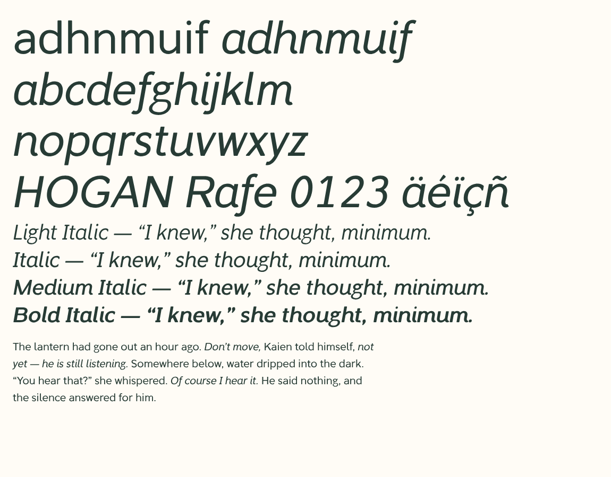

# SEIHouse Noto — Redraw 02 (candidate)

Owner brief: **a warmer version of Google Noto Sans**, as an original family. On
2026-11-12 the owner asked for SEIHouse Noto to be reimagined: more professional,
with its own flavour intact. This folder is that candidate. **Balanced (study B)
remains the approved direction** until the owner decides otherwise; nothing in
`../warmth/` is changed.


[Enlarged letters](proofs/redraw-details.png) ·
[On dark](proofs/redraw-dark.png) ·
[Four weights](proofs/redraw-family.png) ·
[Phone width](proofs/redraw-mobile.png) ·
[Every glyph](proofs/redraw-glyphs.svg) ·
[True italics](proofs/redraw-italic.png) ·
[Every italic glyph](proofs/redraw-glyphs-italic.svg)

## What changed, and why

The earlier drawings expand one centreline by a constant 74 units. That is why they
read light, why joins clot, and why horizontals look heavier than verticals. Redraw 02
replaces that construction:

| | Refinement 01 | Redraw 02 |
|---|---|---|
| Stroke | One 74-unit line everywhere | Follows direction: 88 upright, 74 horizontal (Regular) |
| Joins | Arch meets stem at full weight | Arch and bowl taper to about half weight at the stem |
| Regular weight | Reads as a Light | Text weight, near Noto Sans Regular |
| Proportions | x-height 530, capitals 717, ascender 710 | x-height 520, capitals 700, ascender 744 |
| Spacing | Grouped sidebearings, 34 pairs | Shape-based sidebearings, automatic kerning |
| Weights | Regular | Light, Regular, Medium, Bold, each with a true italic |
| Characters | 94 | 343 (complete printable Basic Latin, Latin-1 and Latin Extended-A, plus Romanian, Welsh and everyday symbols) |

## What stays (the SEIHouse flavour)

- Balanced's moderate softness: every outside corner is rounded by one radius
  (13 units at Regular), at every weight.
- Balanced's full curve (the .585 bowl parameter) on every round letter.
- Two-storey a and g, hooked l, curved y tail, serifed I and flagged 1, so I / l / 1
  stay distinct.
- Original construction. No outlines, metrics or kerning come from SEIHouse Sans,
  Display, Google Noto or any other font. The Noto reference file is opened only
  by the comparison page.

## True italics

Novel dialogue, inner thoughts and UI emphasis need an italic that is drawn, not a
browser's faked slant. Every weight now has one: **Light Italic, Italic, Medium Italic
and Bold Italic** (`SEIHouseNoto-LightItalic` … `-BoldItalic`).



- **Drawn forms** (`cursive()` in `letters.py`): single-storey a; n, m, h, u, i, a and d
  finish in a short exit stroke that leans toward the next letter; arches branch lower
  out of the stem (222 instead of 182 units); f descends below the baseline with a hook.
  The exit-stroke curve is sized from the stem, so Bold keeps a smooth inner curve, and
  is a little shorter in heavier weights, which are fitted closer.
- **Kept from upright**: two-storey g, hooked l, curved y, serifed I and flagged 1, the
  same softness, full curve and stroke modulation. Capitals and figures are the upright
  drawings slanted.
- **Slant and colour**: 10°, sheared about the middle of the x-height, and 4% narrower.
  Stems are drawn heavier first, so after condensing and slanting the italic matches its
  upright's colour. Figures keep the 572-unit tabular width.
- **Spacing**: each exit-stroke letter carries a *ghost* (the letter without its exit
  stroke). Sidebearings, accent placement and kerning rhythm follow the ghost, so `nn`,
  `in`, `an` are unkerned; collision clearance is still checked on the real ink.
- **Style linking**: Italic and Bold Italic join SEIHouse Noto's Regular/Bold group;
  Light Italic and Medium Italic sit in their weight's legacy family, and every face
  carries typographic family "SEIHouse Noto". Italic flags, `italicAngle` −10° and the
  caret slope are set, so apps and browsers pick the real italic for `font-style: italic`.

```css
@font-face { font-family: "SEIHouse Noto"; font-style: italic; font-weight: 400;
             src: url(fonts/SEIHouseNoto-Italic.woff2) format("woff2"); }
```

The upright fonts are byte-for-byte unchanged.

## How it is built

- `pen.py` — the drawing engine: a modulated ribbon around a centreline (thickness
  from stroke direction, optional taper per node), straight bars, unions and one
  corner-softening pass.
- `letters.py` — every drawing, plus the accent table. A weight is one number;
  heavier weights are drawn slightly wider and fitted slightly closer.
- `spacing.py` — kerning from the outlines: each pair is adjusted until its
  weighted gap matches "nn" / "HH", with a clearance floor. Accented letters
  share their base's kerning, with exceptions where an accent meets an overhang.
- `build.py` — fonts, `manifest.json`, the glyph sheet, and the page's character list.

```sh
pip install -r requirements.txt
python noto/studies/redraw/build.py
python -m unittest tests.test_noto_redraw
```

## Scope and honest limits

Latin only. This is a design candidate, version 0.010, not a release.

- Heavier weights thin horizontal crossbars and open enclosed loops (`a, e, g, s, B, 8`),
  and lowercase `g` carries a lighter neck and lower loop to match `a, e, o` in
  paragraphs; Light and Medium otherwise come directly from the shared weight rules.
- Printable Basic Latin, Latin-1 Supplement and Latin Extended-A are complete (alongside
  Romanian `Ș ș Ț ț`, Welsh `Ẁ–Ẅ Ỳ ỳ`, and everyday typography symbols). Wider Latin
  blocks (Extended-B, Vietnamese) and non-Latin scripts are not drawn yet. The exact set
  is in `manifest.json`; the comparison page reports any character it has to borrow.
- Accented letters are composed by rule and have not had native-reader review.
  Decomposed (combining-mark) input is not supported yet.
- No Night grade, no hinting beyond alignment zones, and no native iPhone / Windows
  rendering review yet. Italic accents are composed by the same rules as upright and
  have not had native-reader review; the ij digraph and ordinals ª º keep upright forms.
- The stress-angle setting exists in the engine and is left at 0°: at this low
  contrast a tilt was not visible in text.
- The public family name is still an open owner decision (handbook OD-01); the
  fonts carry "SEIHouse Noto" as the working name.
