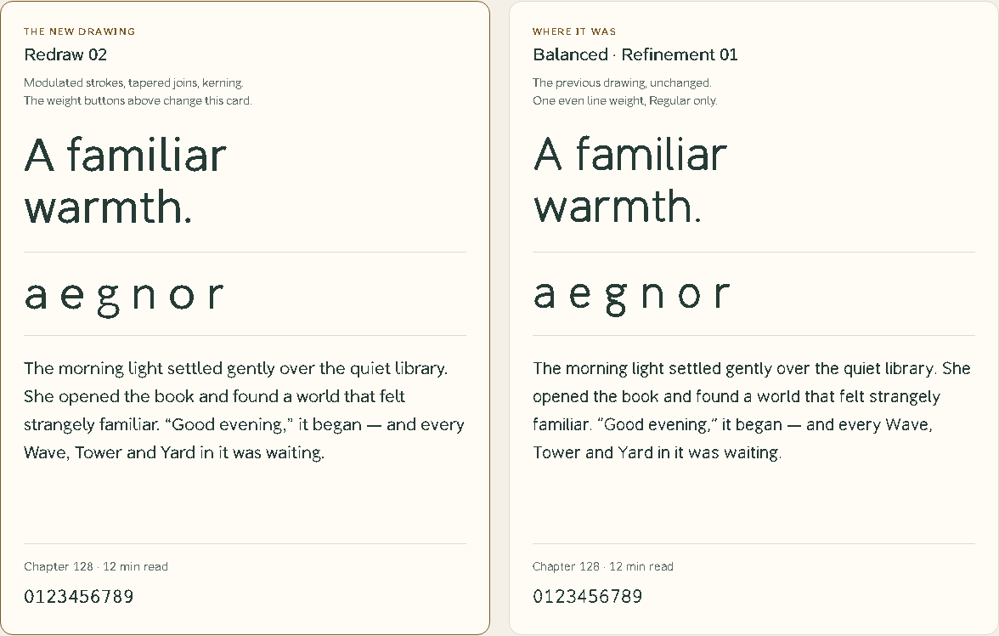

# SEIHouse Noto — Redraw 02 (candidate)

Owner brief: **a warmer version of Google Noto Sans**, as an original family. On
2026-11-12 the owner asked for SEIHouse Noto to be reimagined: more professional,
with its own flavour intact. This folder is that candidate. **Balanced (study B)
remains the approved direction** until the owner decides otherwise; nothing in
`../warmth/` is changed.



[Enlarged letters](proofs/redraw-details.png) ·
[On dark](proofs/redraw-dark.png) ·
[Four weights](proofs/redraw-family.png) ·
[Phone width](proofs/redraw-mobile.png) ·
[Every glyph](proofs/redraw-glyphs.svg)

## What changed, and why

The earlier drawings expand one centreline by a constant 74 units. That is why they
read light, why joins clot, and why horizontals look heavier than verticals. Redraw 02
replaces that construction:

| | Refinement 01 | Redraw 02 |
|---|---|---|
| Stroke | One 74-unit line everywhere | Follows direction: 88 upright, 74 horizontal (Regular) |
| Joins | Arch meets stem at full weight | Arch and bowl taper to about half weight at the stem |
| Regular weight | Reads as a Light | Text weight, near Noto Sans Regular |
| Proportions | x-height 530, capitals 717, ascender 710 | x-height 520, capitals 700, ascender 744 |
| Spacing | Grouped sidebearings, 34 pairs | Shape-based sidebearings, automatic kerning |
| Weights | Regular | Light, Regular, Medium, Bold |
| Characters | 94 | 314 (keyboard symbols, most Latin-1 and Latin Extended-A; gaps listed below) |

## What stays (the SEIHouse flavour)

- Balanced's moderate softness: every outside corner is rounded by one radius
  (13 units at Regular), at every weight.
- Balanced's full curve (the .585 bowl parameter) on every round letter.
- Two-storey a and g, hooked l, curved y tail, serifed I and flagged 1, so I / l / 1
  stay distinct.
- Original construction. No outlines, metrics or kerning come from SEIHouse Sans,
  Display, Google Noto or any other font. The Noto reference file is opened only
  by the comparison page.

## How it is built

- `pen.py` — the drawing engine: a modulated ribbon around a centreline (thickness
  from stroke direction, optional taper per node), straight bars, unions and one
  corner-softening pass.
- `letters.py` — every drawing, plus the accent table. A weight is one number;
  heavier weights are drawn slightly wider and fitted slightly closer.
- `spacing.py` — kerning from the outlines: each pair is adjusted until its
  weighted gap matches "nn" / "HH", with a clearance floor. Accented letters
  share their base's kerning, with exceptions where an accent meets an overhang.
- `build.py` — fonts, `manifest.json`, the glyph sheet, and the page's character list.

```sh
pip install -r requirements.txt
python noto/studies/redraw/build.py
python -m unittest tests.test_noto_redraw
```

## Scope and honest limits

Latin only. This is a design candidate, version 0.010, not a release.

- Bold and Light come from the same rules as Regular and have had less individual
  attention; Bold counters in a, e, g and s are the first place to look.
- Coverage is not complete Latin-1 or Latin Extended-A. Not drawn yet:
  `¤ ¦ § ¨ © ª ¬ ® ¯ ² ³ ´ µ ¶ ¸ ¹ º ¼ ½ ¾` and `ĸ IJ ij Ŀ ŀ ʼn Ŋ ŋ ſ`. The exact set is
  in `manifest.json`; the comparison page reports any character it has to borrow.
- Accented letters are composed by rule and have not had native-reader review.
  Decomposed (combining-mark) input is not supported yet.
- No italic, no Night grade, no hinting beyond alignment zones, and no native
  iPhone / Windows rendering review yet.
- The stress-angle setting exists in the engine and is left at 0°: at this low
  contrast a tilt was not visible in text.
- The public family name is still an open owner decision (handbook OD-01); the
  fonts carry "SEIHouse Noto" as the working name.
