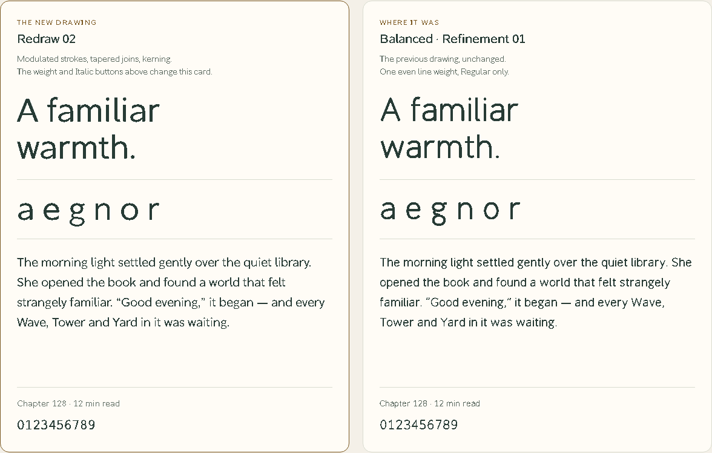
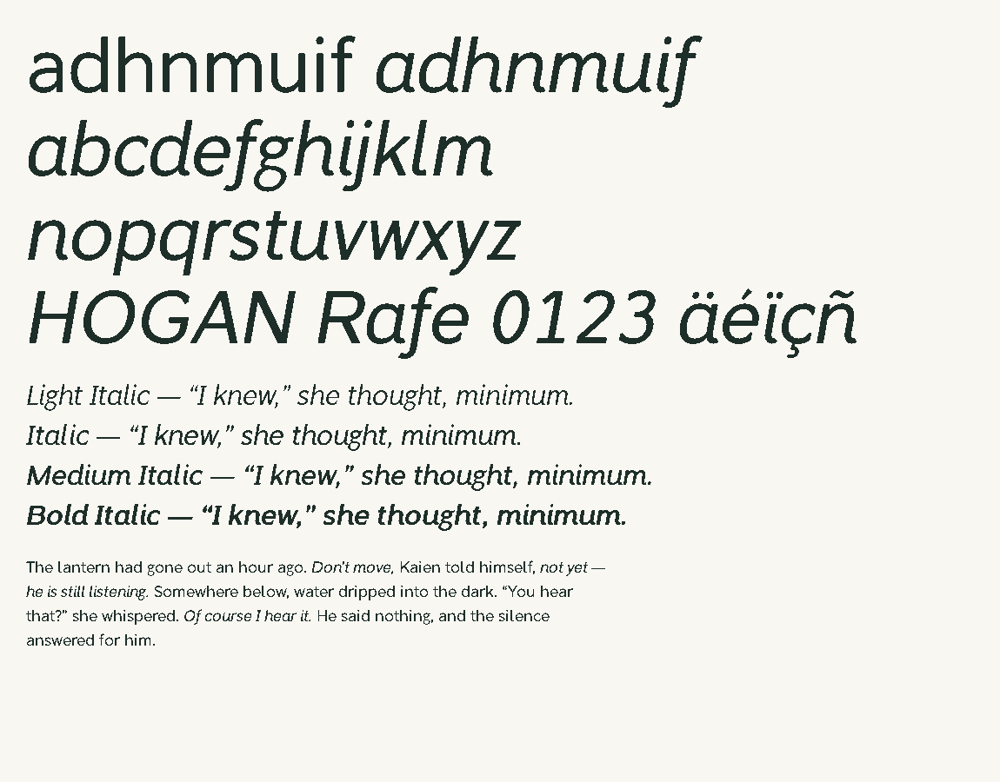
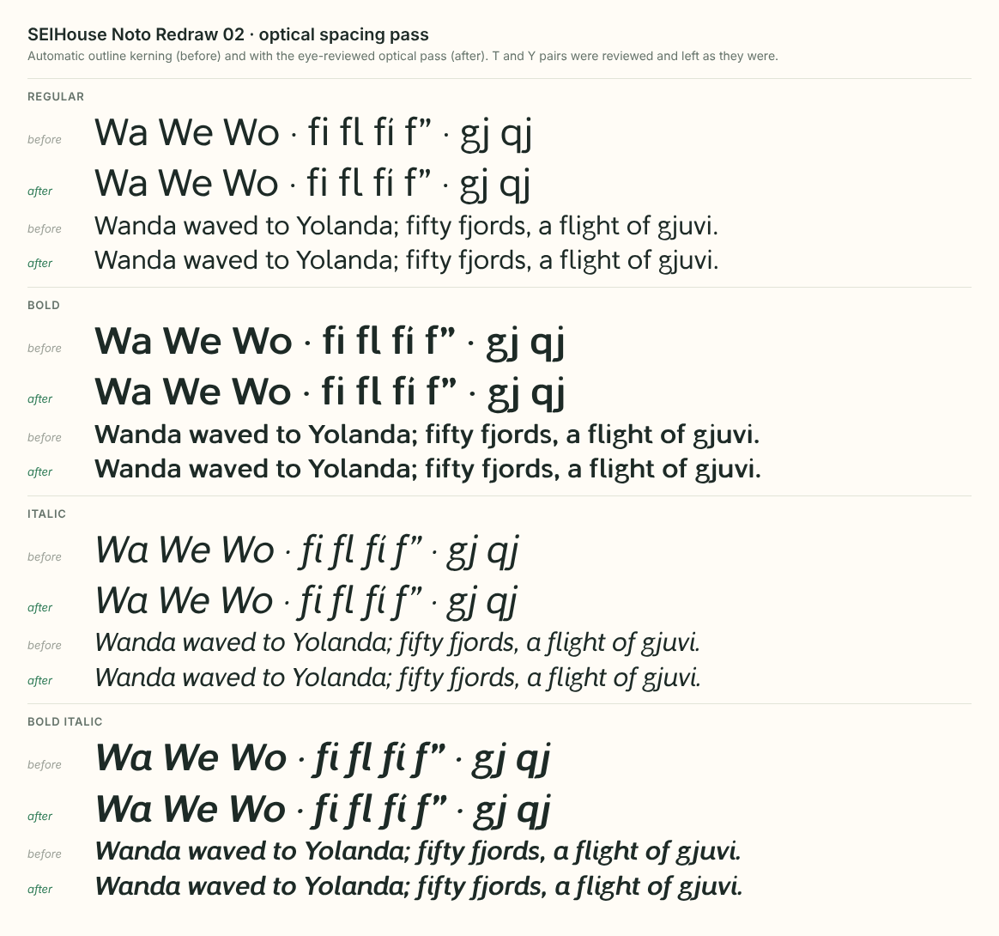
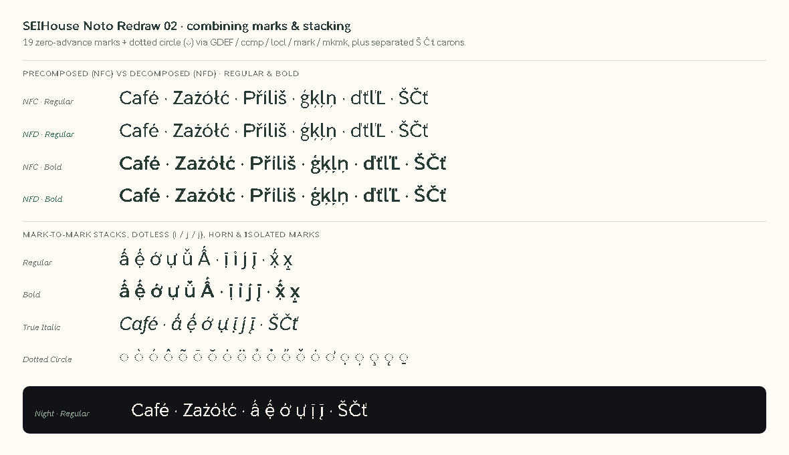

# SEIHouse Noto — Redraw 02 (candidate)

Owner brief: **a warmer version of Google Noto Sans**, as an original family. On
2026-11-12 the owner asked for SEIHouse Noto to be reimagined: more professional,
with its own flavour intact. This folder is that candidate. **Balanced (study B)
remains the approved direction** until the owner decides otherwise; nothing in
`../warmth/` is changed.



[Enlarged letters](proofs/redraw-details.png) ·
[On dark](proofs/redraw-dark.png) ·
[Four weights](proofs/redraw-family.png) ·
[Phone width](proofs/redraw-mobile.png) ·
[Every glyph](proofs/redraw-glyphs.svg) ·
[True italics](proofs/redraw-italic.png) ·
[Every italic glyph](proofs/redraw-glyphs-italic.svg) ·
[Optical spacing, before and after](proofs/redraw-optical.png) ·
[Combining marks &amp; stacking](proofs/redraw-marks.png)

## What changed, and why

The earlier drawings expand one centreline by a constant 74 units. That is why they
read light, why joins clot, and why horizontals look heavier than verticals. Redraw 02
replaces that construction:

| | Refinement 01 | Redraw 02 |
|---|---|---|
| Stroke | One 74-unit line everywhere | Follows direction: 88 upright, 74 horizontal (Regular) |
| Joins | Arch meets stem at full weight | Arch and bowl taper to about half weight at the stem |
| Regular weight | Reads as a Light | Text weight, near Noto Sans Regular |
| Proportions | x-height 530, capitals 717, ascender 710 | x-height 520, capitals 700, ascender 744 |
| Spacing | Grouped sidebearings, 34 pairs | Shape-based sidebearings, automatic kerning |
| Weights | Regular | Light, Regular, Medium, Bold, each with a true italic, plus a Night grade for Light, Regular, Medium |
| Characters | 94 | 363 (complete printable Basic Latin, Latin-1 and Latin Extended-A, Romanian, Welsh, everyday symbols, dotted circle `◌` and 19 combining marks) |

## What stays (the SEIHouse flavour)

- Balanced's moderate softness: every outside corner is rounded by one radius
  (13 units at Regular), at every weight.
- Balanced's full curve (the .585 bowl parameter) on every round letter.
- Two-storey a and g, hooked l, curved y tail, serifed I and flagged 1, so I / l / 1
  stay distinct.
- Original construction. No outlines, metrics or kerning come from SEIHouse Sans,
  Display, Google Noto or any other font. The Noto reference file is opened only
  by the comparison page.

## True italics

Novel dialogue, inner thoughts and UI emphasis need an italic that is drawn, not a
browser's faked slant. Every weight now has one: **Light Italic, Italic, Medium Italic
and Bold Italic** (`SEIHouseNoto-LightItalic` … `-BoldItalic`).



- **Drawn forms** (`cursive()` in `letters.py`): single-storey a; n, m, h, u, i, a and d
  finish in a short exit stroke that leans toward the next letter; arches branch lower
  out of the stem (222 instead of 182 units); f descends below the baseline with a hook.
  The exit-stroke curve is sized from the stem, so Bold keeps a smooth inner curve, and
  is a little shorter in heavier weights, which are fitted closer.
- **Kept from upright**: two-storey g, hooked l, curved y, serifed I and flagged 1, the
  same softness, full curve and stroke modulation. Capitals and figures are the upright
  drawings slanted.
- **Slant and colour**: 10°, sheared about the middle of the x-height, and 4% narrower.
  Stems are drawn heavier first, so after condensing and slanting the italic matches its
  upright's colour. Figures keep the 572-unit tabular width.
- **Spacing**: each exit-stroke letter carries a *ghost* (the letter without its exit
  stroke). Sidebearings, accent placement and kerning rhythm follow the ghost, so `nn`,
  `in`, `an` are unkerned; collision clearance is still checked on the real ink.
- **Style linking**: Italic and Bold Italic join SEIHouse Noto's Regular/Bold group;
  Light Italic and Medium Italic sit in their weight's legacy family, and every face
  carries typographic family "SEIHouse Noto". Italic flags, `italicAngle` −10° and the
  caret slope are set, so apps and browsers pick the real italic for `font-style: italic`.

```css
@font-face { font-family: "SEIHouse Noto"; font-style: italic; font-weight: 400;
             src: url(fonts/SEIHouseNoto-Italic.woff2) format("woff2"); }
```

The upright fonts are byte-for-byte unchanged.

## Night optical grade

Light, Regular, and Medium ship a zero-reflow Night grade in both upright and italic
(`Light Night`, `Regular Night`, `Medium Night`, `Light Italic Night`, `Italic Night`,
`Medium Italic Night`), built with `NIGHT_GRADE = -4`:

- Thinner strokes (`w = weight - 4/88`): upright stems thin by 4.00 units (and italic stems
  proportionately), countering the white-on-dark halation bloom at reading weights while
  leaving Bold and Bold Italic at full weight.
- Zero reflow: every Night glyph locks onto its paired Day advance width with the thinned
  ink centred inside, and reuses the Day font's exact `GPOS` kerning table — switching
  between Day and Night never shifts a line break.

## Optical spacing pass

The automatic kerning balances the *measured* gap of every pair. The eye does not
read gaps as a ruler does, so a polish pass (`optical.py`) sits on top of it. It came
from reading real words at every weight, upright and italic: `To`, `Te`, `Wa`, `Yo`, and
italic `ff`, `fi`, `gj`, in sentences as well as in isolation.



| What the eye saw | Rule | Example (Regular → Italic) |
|---|---|---|
| W sat looser than V beside the same letter, most visibly in italic (*Wanda*, *Waved*) | W with a lowercase letter kerns at least ¾ of V's value | `Wa` −29 → −37, italic −14 → −25 |
| The f terminal crowded an i dot, accent, ascender or closing quote (*fifty* clotted in Bold Italic) | Above the x-height an f gets about one stem of air, opened by at most 0.16 stem; `ff` keeps its shared crossbar | italic `fi` 0 → +14, Bold `fi` 0 → +21 |
| `gj` opened a hole at the x-height: tucked descenders were pushing the letters apart | Between letters, descender contact only needs a smaller clearance (12 units) and never loosens the rhythm | `gj` +31 → 0 (Bold +38 → +24), `jj` +20 → 0 |

Reviewed and left as they were: `T` and `Y` with lowercase (`To`, `Te`, `Ta`, `Tr`, `Ty`,
`Yo`, `Ya`, `Ye`) already read evenly. Upright Light and Regular `fi` already have enough
air, so the f rule leaves them as they were. Punctuation pairs are untouched by the
descender rule. About 70–190 pairs change per weight; every kerned pair still keeps clear ink.
Night fonts reuse their Day kerning, so they inherit the pass with zero reflow between Day and Night.
`spacing.kerning(..., optical_pass=False)` gives the purely measured kerning for comparison.

## Combining marks and OpenType layout

Decomposed and multi-mark text now shapes identically to precomposed Latin across all
14 faces (four weights, true italics, and Night grades), while keeping Day and Night
line breaks locked together:



- **Repertoire (`363` printable characters)**: adds 19 zero-advance combining marks
  (`U+0300`–`U+0304`, `U+0306`–`U+030C`, `U+0312`, `U+031B` horn, `U+0323` dot below,
  `U+0326`–`U+0328`, `U+0331` macron below) and dotted circle `◌` (`U+25CC`), plus
  unencoded `u012F.dotless` so `į` drops its dot cleanly under above-base marks.
- **Canonical composition and `locl`**: `GSUB` `ccmp` composes all 173 canonical
  base+mark pairs (including Latvian `g` + `U+0312` → `ģ`) and swaps `i`, `j`, `į` to
  dotless bases before above marks; `locl` maps both precomposed and decomposed Romanian/Moldovan
  `Ş ş Ţ ț` to `Ș ș Ț ț`.
- **Anchors and stacking (`GDEF`, `mark`, `mkmk`, `kern`)**: `GDEF` classifies bases (`1`)
  and combining marks (`3`); every base letter (and `◌`) carries `top`, `bottom`, and
  where needed `horn` and `ogonek` anchors, sheared at 10° in italics and centered on the
  letter ghost rather than exit strokes. `mkmk` stacks above and below marks independently,
  `kern` carries `IgnoreMarks` so kerning works across combining marks, and Night faces
  reuse their Day `GDEF`/`GSUB`/`GPOS` tables byte-for-byte.

## How it is built

- `pen.py` — the drawing engine: a modulated ribbon around a centreline (thickness
  from stroke direction, optional taper per node), straight bars, unions and one
  corner-softening pass.
- `letters.py` — every drawing, plus the accent table. A weight is one number;
  heavier weights are drawn slightly wider and fitted slightly closer.
- `spacing.py` — kerning from the outlines: each pair is adjusted until its
  weighted gap matches "nn" / "HH", with a clearance floor. Accented letters
  share their base's kerning, with exceptions where an accent meets an overhang.
- `optical.py` — the eye-reviewed optical spacing pass applied on top of `spacing.py`.
- `build.py` — fonts, `manifest.json`, the glyph sheet, and the page's character list.

```sh
pip install -r requirements.txt
python noto/studies/redraw/build.py
python -m unittest tests.test_noto_redraw
```

## Scope and honest limits

Latin only. This is a design candidate, version 0.011, not a release.

- Heavier weights thin horizontal crossbars and open enclosed loops (`a, e, g, s, B, 8`).
  For even texture at 14–18 px in Regular and Bold, lowercase `g` uses a compact
  curved neck and rounded closed lower loop seated under its bowl with balanced
  right sidebearing, `s` calms its diagonal spine weight, and `a` and `e` balance
  arch weight and counter openness; Light and Medium otherwise come directly from
  the shared weight rules.
- Printable Basic Latin, Latin-1 Supplement and Latin Extended-A are complete (alongside
  Romanian `Ș ș Ț ț`, Welsh `Ẁ–Ẅ Ỳ ỳ`, dotted circle `◌`, 19 combining marks, and everyday
  typography symbols). Precomposed extended blocks (Extended-B, precomposed Vietnamese
  `U+1EA0–U+1EF9`) and non-Latin scripts are not encoded yet; decomposed sequences using
  those 19 marks shape through `ccmp`, `mark` and `mkmk`. The exact set is in `manifest.json`;
  the comparison page reports any character it has to borrow.
- Accented letters, combining-mark attachment, and mark-to-mark stacking are rule-built and
  verified automatically for `NFC == NFD`, contour clearance, and zero clipping; native-reader
  review is still ahead.
- No hinting beyond alignment zones, and no native iPhone / Windows
  rendering review yet. Italic accents are composed by the same rules as upright and
  have not had native-reader review; the ij digraph and ordinals ª º keep upright forms.
- The stress-angle setting exists in the engine and is left at 0°: at this low
  contrast a tilt was not visible in text.
- The public family name is still an open owner decision (handbook OD-01); the
  fonts carry "SEIHouse Noto" as the working name.
