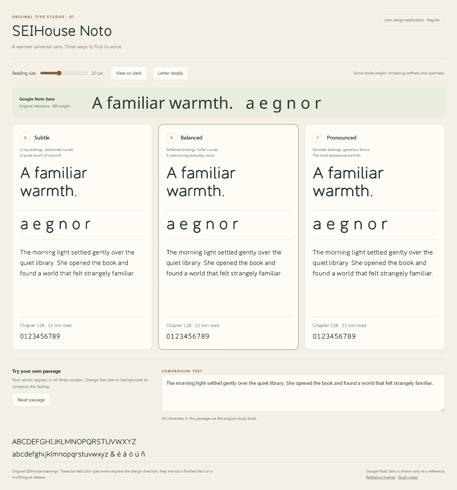

# SEIHouse Noto — warmth studies 01

Owner brief: **a warmer version of Google Noto Sans**, as an original new family.

## View the samples on GitHub

These images open directly on GitHub, including on a phone. No local files or
font installation are needed.



[Enlarged letter comparison](proofs/noto-warmth-details.png) ·
[Dark comparison](proofs/noto-warmth-dark.png) ·
[Balanced study at phone width](proofs/noto-warmth-mobile-b.png)

The downloadable `SEIHouse-Noto-Warmth-Studies.html` also embeds all four fonts
and the reference license for an interactive, offline comparison. GitHub displays
HTML source rather than running this page; use the images above for immediate viewing.

## Interactive study

Open `index.html` through a local web server. Three actual original CFF/WOFF2 font
builds compare terminal softness, bowl fullness, and horizontal proportions:

| Study | Terminal corner radius | Curve fullness | Width factor |
|---|---:|---:|---:|
| A — Subtle | 3 source units | .545 | 1.000 |
| B — Balanced | 14 source units | .585 | 1.025 |
| C — Pronounced | 29 source units | .625 | 1.050 |

All three use a 74-unit construction stroke on a 1000-unit em. These are exploratory
parameters, not settled rules for other scripts. The source is `build_samples.py`:
independently authored paths, bowls, terminal construction, and spacing. No Sans,
Display, or external font outlines, metrics, anchors, or kerning were imported.
The builder uses generic fontTools and PathOps libraries.

## Scope

Limited Latin samples: upper/lowercase, digits, selected punctuation, and a few
accented letters. The page reports characters outside this repertoire. There are
no Arabic, Indic, East Asian, or other script-support claims, no certified reading
metrics, and no production release. The custom outlines need further refinement
and native/script-specific design studies after the owner chooses a direction.

## Reference and provenance

`reference/NotoSans-Reference.ttf` is the unchanged Google Noto Sans variable font,
used only by the labeled reference row at weight 400. Its upstream OFL is preserved
in `reference/OFL.txt`. Download URLs are pinned to Google Fonts commit
`9862abc066c9b83bf84c3e8ed1fc2d8d48f9bbf0`; exact source hashes are in
`reference/provenance.json`. The reference file is never opened by the original
font construction functions. Original output hashes and character sets are in
`manifest.json`.

## Rebuild

From the repository root:

```powershell
.\.venv\Scripts\python.exe noto/studies/warmth/build_samples.py
```

Generated assets stay inside this study folder. Existing fonts and release
pipelines are unaffected. No font installation is required to view the page.

## Verification and proof capture

Chromium checks confirm that each study renders with its own custom font, the
controls work, and reading/detail views fit widths of 360, 390, 768, 1024, and
1440 pixels. The standalone HTML loads its embedded fonts without external font
requests. These checks do not establish native iPhone rendering or reading comfort.

Serve this folder on port 8767, then run `verify_browser.js` through Playwright
CLI's `run-code --filename` option. Run `capture_samples.js` afterward to capture
the four screenshots at 2x pixel density under `output/playwright/`; copy those
images into `proofs/` when updating the reviewed samples.
